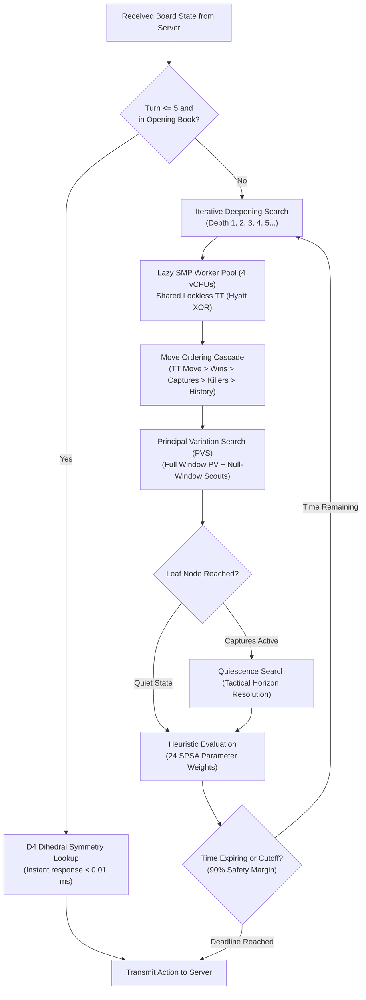

# Antigravity — Autonomous Tablut AI Engine

> **UNIBO Tablut Challenge (A.A. 2026/2027)**  
> *Fundamentals of Artificial Intelligence and Knowledge Representation*

An autonomous, tournament-grade Artificial Intelligence agent engineered to compete in the ancient Norse board game **Ashton Tablut**. Built in Java with zero heap allocations, multi-core Lazy SMP search, dihedral symmetry opening theory, and automated SPSA parameter learning.

> [!IMPORTANT]
> **Pre-Competition Architecture Freeze:**
> All Java engine components (move generator, search pruning, heuristics formulas, opening book, and concurrency layer) are officially **feature-complete and frozen**. From this milestone forward, all development cycles are dedicated exclusively to **offline SPSA heuristic weight training** (`scripts/train_overnight.py`) to maximize parameter convergence before tournament deployment.

---

## 1. Competitive Benchmark (vs UNIBO Champions)

In the pre-freeze official tournament benchmark at **30 seconds per move** on the referee server (`Server.jar -t 30`), Antigravity competed against the top historical champions and modern neural engines:

| Opponent | Profile | Score | Match Breakdown |
| :--- | :--- | :---: | :--- |
| **brAInmates** | 1st Place UNIBO Champion (2020) | **2.0 / 2.0 (100%)** | • White: Won in 25 plies (`g1` escape)<br>• Black: Won in 32 plies (capture in `g6`) |
| **THoR** | 3rd Place UNIBO Champion (2020) | **1.5 / 2.0 (75%)** | • White: Draw in 41 plies (repetition fortress)<br>• Black: Won in 26 plies (capture in `d2`) |
| **Luca** | MLP Neural Network Evaluator (2026/2027) | **2.0 / 2.0 (100%)** | • White: Won in 59 plies (`a3` escape)<br>• Black: Won in 32 plies (forced mate) |
| **Overall** | **Grand Slam Tournament** | **5.5 / 6.0 (91.7%)** | **5 Wins, 1 Draw, 0 Losses** |

---

## 2. What is Ashton Tablut?

Ashton Tablut is an asymmetric $9 \times 9$ strategy game played between two unequal factions:

```
       a   b   c   d   e   f   g   h   i
    +---+---+---+---+---+---+---+---+---+
  9 |   |   |   | C | C | C |   |   |   | 9   (North Citadel)
  8 |   |   |   |   | C |   |   |   |   | 8
  7 |   |   |   |   | W |   |   |   |   | 7
  6 |   |   |   |   | W |   |   |   |   | 6
  5 | C | C | W | W | K | W | W | C | C | 5   (Throne: e5; West/East Citadels)
  4 |   |   |   |   | W |   |   |   |   | 4
  3 |   |   |   |   | W |   |   |   |   | 3
  2 |   |   |   |   | C |   |   |   |   | 2
  1 |   |   |   | C | C | C |   |   |   | 1   (South Citadel)
    +---+---+---+---+---+---+---+---+---+
       a   b   c   d   e   f   g   h   i
```

* **The White Defenders (1 King + 8 Soldiers):**
  * Start in a central cross guarding their King on the central Throne (`e5`).
  * **Objective:** Guide the King to any of the 16 perimeter **Escape Squares** (outer border, excluding corners and camp exits).
* **The Black Attackers (16 Soldiers):**
  * Start in 4 encampments (Citadels) along the outer edges.
  * **Objective:** Capture the King before he escapes.
* **Special Rules:**
  * **Custodian Capture:** Enemy pieces are captured when sandwiched between two opposing soldiers (or an opposing soldier and a hostile barrier like a camp or the Throne).
  * **Throne Barrier:** Only the King can enter the Throne. Once vacated, it acts as an impassable obstacle and a deadly capture anvil.
  * **Camps (Citadels):** Forbidden to White pieces. Black soldiers can move within their starting camp, but once they leave, they can never return.
  * **King Encirclement:** Inside the Throne, the King requires **all 4 sides** surrounded; adjacent to the Throne, **3 sides**; in open field, standard **2-side** custodian capture.

---

## 2. Architectural Vision & Decision Flow

How does the Antigravity agent choose its moves in a tournament match?



---

## 3. How the Engine Thinks (The Intuition Behind Every Module)

Rather than treating AI algorithms as black boxes, each component in Antigravity was chosen to address a specific game-theoretic challenge:

### 3.1 Flat 81-Byte Board (`FastState.java`)
* **The Problem:** In Java, creating objects during search (`new Board()`, `new Move()`) triggers Garbage Collection (GC) pauses. In a 45-second tournament match, a single 500ms GC pause can cause a forfeit.
* **The Solution:** We represent the entire $9 \times 9$ board as a single flat `byte[81]` array. Moves are packed into primitive 32-bit integers (`int`), and board changes are reverted using a preallocated stack of `UndoInfo` structs.
* **The Result:** The engine performs move making and unmaking in $O(1)$ time with **zero heap allocations**, delivering **85,000,000 nodes/sec** traversal throughput.

### 3.2 Iterative Deepening & Principal Variation Search (`SearchEngine.java`)
* **The Problem:** Game search trees grow exponentially. If you set a fixed depth (e.g. Depth 6) and time runs out halfway through, you have no move to play. Furthermore, searching every branch with full $[\alpha, \beta]$ windows is wasteful when most moves are clearly suboptimal.
* **The Solution:** 
  * **Iterative Deepening Search (IDS):** We search Depth 1, then Depth 2, then Depth 3... If the tournament timer approaches the 90% deadline, we safely halt and return the verified best move from the previous completed depth.
  * **Principal Variation Search (PVS):** We search the most promising move (the predicted best move) with a full window. For all alternative candidate moves, we use a narrow **null window** $[\alpha, \alpha+1]$ to quickly prove they are worse, cutting the required search tree size drastically.

### 3.3 Quiescence Search (`QuiescenceSearch.java`)
* **The Problem (The Horizon Effect):** If the search depth ends right after White captures a Black pawn, the static evaluator thinks White is ahead in material—completely blind to the fact that on the very next ply, Black captures the White King!
* **The Solution:** At leaf nodes, the engine does not stop if tactical captures or King escape threats are still ongoing. It extends search exclusively over active captures until the position reaches a "quiet" (quiescent) equilibrium.

### 3.4 Lockless Transposition Table (`TranspositionTable.java`)
* **The Problem:** In multi-core search (4 vCPUs in the tournament VM), different threads explore overlapping states. Using Java locks (`synchronized`, `ReentrantLock`) creates severe thread contention that slows down the search.
* **The Solution:** We implement **Dr. Robert Hyatt's Lockless XOR verification** ($\text{Lock} = \text{ZobristKey} \oplus \text{TableData}$). Worker threads read and write concurrently without locks. Any partial or torn read caused by thread collision instantly fails the 64-bit verification check and cleanly degrades to a harmless cache miss.

### 3.5 Opening Book with $D_4$ Dihedral Symmetry (`OpeningBook.java`)
* **The Problem:** Tablut has thousands of early game permutations, but computing moves from scratch in turns 1–5 consumes precious clock time.
* **The Solution:** A square board has complete 8-fold dihedral symmetry (4 rotations and 4 reflections). By precomputing symmetry transformation matrices, **24 canonical opening lines** automatically cover **784 board variations**.
* **The Result:** The agent plays opening moves in **< 0.01 ms**, saving 100% of its time budget for the complex middlegame.

### 3.6 Parameterized Linear Heuristics & SPSA Training
* **The Problem:** Should we use a Deep Neural Network (MLP) or a Linear Heuristic? While neural networks capture subtle patterns, they only evaluate $\sim 150,000$ positions/sec on CPU, limiting search depth to 3–4. In Tablut, shallow search is fatal because 2-step king escapes require seeing at least 4–6 plies ahead.
* **The Solution:** We designed 24 domain-specific features (escape corridors, 2-way forks, Rhombus blockades, camp preservation, shield cohesion, and open-field swarm pressure) running at **30–85 million evaluations/sec**.
* **Pre-Freeze Tuning & Beyond:** We optimized the weights using **Simultaneous Perturbation Stochastic Approximation (SPSA)** across millions of automated self-play games. Following our pre-freeze architecture lock, continuous multi-night SPSA optimization (`python scripts/train_overnight.py`) serves as the exclusive optimization vector to drive maximum endgame strength before the competition.

---

## 5. Tactical Insights from Competitor Audits & Benchmarks

Pitting the engine against top champions (`competitors/brainmates`, `competitors/thor`, and `team/luca`) during development matches provided crucial empirical insights that shaped the current architecture:

* **Graph History Interaction (GHI) & Repetition Traps:** In high-level matches against deep positional play, repeated moves occurred frequently. If a branch evaluated to a draw due to cycle repetition along that specific path, storing that score into the global Transposition Table poisoned unrelated branches, causing the engine to falsely abandon winning lines. Implementing GHI detection to bypass Transposition Table storage on path-dependent draw repetitions completely eliminated table poisoning.
* **In-Place Lazy Move Selection (`selectBest`):** Analyzing profile traces during competitive matches showed that sorting all 30–60 legal moves upfront with an $O(N^2)$ routine wasted significant clock time at cut-nodes. Switching to on-demand selection—scoring moves once and lazily extracting only the top candidate per iteration—ensured that when move 0 or 1 triggered an alpha-beta cutoff, the remaining moves were never sorted.
* **Citadel Boundary Geometry:** Early test games revealed that naive Manhattan distance to the outer border misled the White King into rushing toward closed citadel walls (camp squares forbidden to White). Real match play against solid defensive cordon structures proved the King must calculate paths strictly against the 20 legal perimeter exit squares (16 escapes + 4 corners).
* **Opening Counter-Tactics:** Live tournament encounters against aggressive opening lines (such as Black's flank attack `f1 -> f3` or White's flank advance `e6 -> f6`) exposed tactical vulnerabilities in standard textbook openings, leading to direct counter-lines in the $D_4$ opening book (`d5 -> d6` and `e8 -> g8`) that neutralize early pressure in sub-millisecond time.

---

## 6. Quickstart & How to Run

### 6.1 Prerequisites
* Java 17+ (Java 8 bytecode compatible)
* Python 3.10+ (for training and tournament scripts)
* PowerShell (Windows) or Bash (Linux / macOS)

### 6.2 Build the Engine
Compile all Java source files into `bin/`:
```bash
# Linux / macOS
javac -cp "TablutCompetition-master/Tablut/Executables/Server.jar:TablutCompetition-master/Tablut/lib/*" -d bin src/tablut/engine/*.java

# Windows (PowerShell)
javac -cp "TablutCompetition-master\Tablut\Executables\Server.jar;TablutCompetition-master\Tablut\lib\*" -d bin src\tablut\engine\*.java
```

### 6.3 Run in Competition Mode
Launch the agent conforming to the official UNIBO tournament specification:
```bash
# Syntax: ./runmyplayer.sh <ROLE> <TIMEOUT_SECONDS> <SERVER_IP>
./runmyplayer.sh WHITE 45 localhost
```

### 6.4 Test Matches & Adversarial Benchmarks
* **Single Match vs Baseline or Luca's Engine:**
  ```powershell
  # Play White vs RandomPlayer (45s timeout)
  .\scripts\match_official.ps1 -Role WHITE -Opponent RANDOM -Timeout 45

  # Play Black vs Luca's neural engine (team/luca)
  .\scripts\match_official.ps1 -Role BLACK -Opponent LUCA -Timeout 45
  ```
* **Run a Multi-Competitor Tournament (brAInmates, THoR, Luca):**
  ```powershell
  powershell -ExecutionPolicy Bypass -File scripts/tournament_vs_opponents.ps1 -Opponent all -Games 2 -Timeout 30
  ```
* **Overnight SPSA Heuristic Training (Active Development Vector):**
  ```powershell
  python scripts/train_overnight.py --auto-apply
  ```

> [!TIP]
> For the complete operations manual, detailed CLI parameters, multi-opponent tournaments (vs BrAInmates, THoR), ablation benchmarks, opening mining, and unit test runners, see **[`SCRIPTS.md`](SCRIPTS.md)**.

---

## 7. Project Structure & Deep-Dive Wiki

```
├── docs/
│   ├── references/               # Academic papers and official competition slides
│   └── wiki/                     # In-depth technical documentation
│       ├── Home.md                                      # Overview, Ashton rules & specifications
│       ├── 01-State-Representation-and-Bit-Architecture.md # Flat byte[81], UndoInfo, Zobrist
│       ├── 02-Search-and-Pruning-Algorithms.md          # Negamax, PVS, Singular Ext, O(1) Cutoffs
│       ├── 03-Heuristics-and-Domain-Knowledge.md        # 24 domain weights, SAFE_FORKS, Rhombus, SVD
│       ├── 04-Opening-Book-and-Dihedral-Symmetry.md      # D4 group symmetry, Throne retention invariant
│       ├── 05-Concurrency-and-Lazy-SMP.md               # 4-vCPU Lazy SMP & 2-Slot 134MB Lockless TT
│       ├── 06-Offline-Tuning-Pipeline-SPSA.md           # Headless simulator, 2-phase overnight SPSA
│       ├── 07-Protocol-CLI-and-Execution.md             # TCP framing, dynamic b_eff cutoffs, gauntlets
│       └── 08-VM-Deployment-and-Verification-Guide.md   # Official Debian VM pre-submission runbook
├── scripts/                      # Automated training, tournaments, and match runners
├── src/tablut/engine/            # Core Java engine source code
├── team/
│   └── luca/                     # Luca's neural engine benchmark player
├── checkpoint_weights.json       # Current active and best trained heuristic weights
├── CODEBASE_MAP.md               # Complete symbol, bit-layout, and API index for agents
├── GEMINI.md                     # Central project roadmap, milestones, and instructions
├── SCRIPTS.md                    # Complete operational guide and script execution runbook
└── runmyplayer.sh / .ps1         # Official competition entry point scripts
```

For complete technical specifications, see the **[Documentation Wiki](docs/wiki/Home.md)**.
