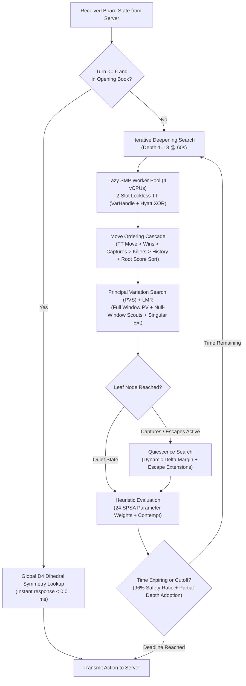

# DajeGeppetto — Autonomous Tablut AI Engine

> **UNIBO Tablut Challenge (A.A. 2026/2027)**  
> *Fundamentals of Artificial Intelligence and Knowledge Representation*

An autonomous, tournament-grade Artificial Intelligence agent engineered to compete in the ancient Norse board game **Ashton Tablut**. Built in Java with zero heap allocations, multi-core Lazy SMP search, dihedral symmetry opening theory, and automated SPSA parameter learning.

> [!IMPORTANT]
> **Tournament-Certified Release:**
> All Java engine components (move generator, search pruning, heuristic evaluation, opening book, and Lazy SMP concurrency layer) are **feature-complete, frozen, and certified** for deployment in the official UNIBO competition VM. The active 24-weight heuristic vector was calibrated via **38,668 Depth-5/6 CRN SPSA self-play games** (`scripts/overnight_60s_pipeline.py`) and verified across all **12 Java unit test suites**.

---

## 1. What is Ashton Tablut?

Ashton Tablut is an asymmetric $9 \times 9$ strategy game played between two unequal factions:

```
       a   b   c   d   e   f   g   h   i
    +---+---+---+---+---+---+---+---+---+
  9 |   |   |   | C | C | C |   |   |   | 9   (North Citadel)
  8 |   |   |   |   | C |   |   |   |   | 8
  7 |   |   |   |   | W |   |   |   |   | 7
  6 |   |   |   |   | W |   |   |   |   | 6
  5 | C | C | W | W | K | W | W | C | C | 5   (Throne: e5; West/East Citadels)
  4 |   |   |   |   | W |   |   |   |   | 4
  3 |   |   |   |   | W |   |   |   |   | 3
  2 |   |   |   |   | C |   |   |   |   | 2
  1 |   |   |   | C | C | C |   |   |   | 1   (South Citadel)
    +---+---+---+---+---+---+---+---+---+
       a   b   c   d   e   f   g   h   i
```

* **The White Defenders (1 King + 8 Soldiers):**
  * Start in a central cross guarding their King on the central Throne (`e5`).
  * **Objective:** Guide the King to any of the 16 perimeter **Escape Squares** (outer border, excluding corners and camp exits).
* **The Black Attackers (16 Soldiers):**
  * Start in 4 encampments (Citadels) along the outer edges.
  * **Objective:** Capture the King before he escapes.
* **Special Rules:**
  * **Custodian Capture:** Enemy pieces are captured when sandwiched between two opposing soldiers (or an opposing soldier and a hostile barrier like a camp or the Throne).
  * **Throne Barrier:** Only the King can enter the Throne. Once vacated, it acts as an impassable obstacle and a deadly capture anvil.
  * **Camps (Citadels):** Forbidden to White pieces. Black soldiers can move within their starting camp, but once they leave, they can never return.
  * **King Encirclement:** Inside the Throne, the King requires **all 4 sides** surrounded; adjacent to the Throne, **3 sides**; in open field, standard **2-side** custodian capture.

---

## 2. Architectural Vision & Decision Flow

How does the DajeGeppetto agent choose its moves in a tournament match?



---

## 3. How the Engine Thinks (The Intuition Behind Every Module)

Rather than treating AI algorithms as black boxes, each component in DajeGeppetto was chosen to address a specific game-theoretic challenge:

### 3.1 Flat 81-Byte Board (`FastState.java`)
* **The Problem:** In Java, creating objects during search (`new Board()`, `new Move()`) triggers Garbage Collection (GC) pauses. In a 60-second tournament match, a single 500ms GC pause can cause a forfeit.
* **The Solution:** We represent the entire $9 \times 9$ board as a single flat `byte[81]` array. Moves are packed into primitive 32-bit integers (`int`), and board changes are reverted using a preallocated stack of `UndoInfo` structs.
* **The Result:** The engine performs move making and unmaking in $O(1)$ time with **zero heap allocations**, delivering **85,000,000 nodes/sec** traversal throughput.

### 3.2 Iterative Deepening, PVS & LMR (`SearchEngine.java`)
* **The Problem:** Game search trees grow exponentially. If you set a fixed depth (e.g. Depth 6) and time runs out halfway through, you have no move to play. Furthermore, searching every branch with full $[\alpha, \beta]$ windows is wasteful when most moves are clearly suboptimal.
* **The Solution:** 
  * **Iterative Deepening Search (IDS) & Verified Partial-Depth Adoption:** We search Depth 1, 2, 3... up to Depth 13–18 at 60s/move. The engine uses a **96% time safety ratio** (`57.6s` on a `60s` clock), an 82% predictive soft cutoff, and **verified partial-depth root adoption** so completed in-window PV improvements are never wasted when the hard deadline fires.
  * **Principal Variation Search (PVS) & Late Move Reductions (LMR):** The best move is searched with a full aspiration window ($\Delta = 120$ cp); alternative candidates use null windows $[\alpha, \alpha+1]$ and logarithmic LMR reductions (guarded against reducing King-escape or King-threat lines).

### 3.3 Quiescence Search (`QuiescenceSearch.java`)
* **The Problem (The Horizon Effect):** If the search depth ends right after White captures a Black pawn, the static evaluator thinks White is ahead in material—completely blind to the fact that on the very next ply, Black captures the White King!
* **The Solution:** At leaf nodes, the engine extends search over tactical captures and distance-$\le 2$ quiet King escape maneuvers with a **dynamic delta-pruning margin** (preventing high-value captures from being pruned) and direct hard-deadline cancellation.

### 3.4 Lockless 2-Slot Transposition Table (`TranspositionTable.java`)
* **The Problem:** In multi-core search (4 vCPUs in the tournament VM), different threads explore overlapping states. Using Java locks (`synchronized`, `ReentrantLock`) creates severe thread contention that slows down the search.
* **The Solution:** We implement **Dr. Robert Hyatt's Lockless XOR verification** ($\text{Lock} = \text{ZobristKey} \oplus \text{TableData}$) backed by Java **`VarHandle` opaque array reads/writes** across a **2-slot bucket layout** ($2^{23}$ entries, 134 MB RAM: Depth-Preferred Slot 0 + Always-Replace Slot 1). Torn reads cleanly fail the 64-bit XOR check and degrade into harmless cache misses.

### 3.5 Opening Book with Global $D_4$ Dihedral Symmetry (`OpeningBook.java`)
* **The Problem:** Tablut has thousands of early game permutations, but computing moves from scratch in turns 1–6 consumes precious clock time.
* **The Solution:** A square board has complete 8-fold dihedral symmetry (4 rotations and 4 reflections). `OpeningBook` performs a **global $D_4$ symmetry scan** selecting the highest-weight canonical response across all 8 orientations (deterministic $\varepsilon = 0.0$ by default in tournaments), covering **29 canonical systems** with Throne-retention sanitation and flank counter-lines (including `1... e2→g2` responses).
* **The Result:** The agent plays opening moves in **< 0.01 ms**, saving 100% of its time budget for the complex middlegame.

### 3.6 Parameterized Linear Heuristics & Depth-5/6 CRN SPSA Training
* **The Problem:** On pure 4-vCPU hardware without GPU acceleration, heavy neural evaluators throttle search depth, whereas linear bitwise heuristics allow reaching **Depth 13–18** (100M–340M nodes/move at 60s), resolving multi-ply forced mates and escape forks cleanly.
* **The Solution:** We engineered **24 domain-specific features** (escape corridors, 2-way forks, `SAFE_FORKS`, Rhombus blockades with White Rhombus-contest exemption, camp preservation, graduated Throne-abandon protection, shield cohesion, zero-centered draw contempt, and open-field swarm pressure) running at **30.9 million evaluations/sec**.
* **Multi-Stage CRN SPSA Tuning:** Using **Common Random Numbers (CRN)** paired evaluation, Black non-regression gating, and a 4-stage Depth-5/6 pipeline (`scripts/overnight_60s_pipeline.py`), the active weights were distilled from 38,668 deep self-play games and validated via multi-resolution shootouts (Depth 5, 750ms, 1200ms).

---

## 4. Key Engineering Insights & Design Lessons

Iterative profiling, self-play testing, and game-tree diagnostics shaped several core architectural refinements:

* **Graph History Interaction (GHI) & Repetition Traps:** When a branch evaluates to a draw due to cycle repetition along that specific search path, storing that score into the global Transposition Table poisons unrelated branches, causing the engine to falsely abandon winning lines. Implementing GHI detection to bypass Transposition Table storage on path-dependent draw repetitions completely eliminated table poisoning.
* **In-Place Lazy Move Selection (`selectBest`):** Profiling showed that sorting all 30–60 legal moves upfront with an $O(N^2)$ routine wasted significant clock time at cut-nodes. Switching to on-demand selection—scoring moves once and lazily extracting only the top candidate per iteration—ensured that when move 0 or 1 triggered an alpha-beta cutoff, the remaining moves were never sorted.
* **Citadel Boundary Geometry:** Naive Manhattan distance to the outer border misleads the White King into rushing toward closed citadel walls (camp squares forbidden to White). Calculating paths strictly against the 20 legal perimeter exit squares (16 escapes + 4 corners) eliminated boundary-attraction errors.
* **Opening Counter-Tactics:** Testing against aggressive flank openings (`f1 -> f3`, `e6 -> f6`, `e2 -> g2`) exposed tactical vulnerabilities in naive textbook openings, leading to sanitized outer-cross lines and direct $D_4$ counter-lines (`d5 -> d6`, `e8 -> g8`, `e6 -> c6`) executed in sub-millisecond time.

---

## 5. Quickstart & How to Run

### 5.1 Prerequisites
* Java 17+ (Java 8 bytecode compatible)
* Python 3.10+ (for training and verification scripts)
* PowerShell (Windows) or Bash (Linux / macOS)

### 5.2 Build the Engine
Compile all Java source files into `bin/` with explicit UTF-8 encoding:
```bash
# Linux / macOS
javac -encoding UTF-8 -cp "TablutCompetition-master/Tablut/Executables/Server.jar:TablutCompetition-master/Tablut/lib/*" -d bin src/tablut/engine/*.java

# Windows (PowerShell)
javac -encoding UTF-8 -cp "TablutCompetition-master\Tablut\Executables\Server.jar;TablutCompetition-master\Tablut\lib\*" -d bin src\tablut\engine\*.java
```

### 5.3 Run in Competition Mode
Launch the agent conforming to the official UNIBO tournament specification:
```bash
# Syntax: ./runmyplayer.sh <ROLE> <TIMEOUT_SECONDS> <SERVER_IP>
./runmyplayer.sh WHITE 60 localhost
```

### 5.4 Verification, Testing & Offline SPSA Training
* **Automated Pre-Submission Certification (Local Windows / Official Debian VM):**
  ```powershell
  # Local certification (UTF-8 clean build, 8 core test suites, LF check, RandomPlayer smoke match)
  powershell -ExecutionPolicy Bypass -File scripts/verify_local.ps1
  ```
  ```bash
  # Inside the official Debian VM (/home/tablut/tablut)
  ./scripts/verify_vm.sh
  ```
* **Single Local Match vs Baseline `RandomPlayer` (`Server.jar`):**
  ```powershell
  .\scripts\match_official.ps1 -Role WHITE -Opponent RANDOM -Timeout 60
  ```
* **Multi-Stage Depth-5/6 Offline SPSA Training Pipeline:**
  ```powershell
  python scripts/overnight_60s_pipeline.py --skip-server
  ```

> [!TIP]
> For the complete operations manual, CLI parameters, ablation tools, opening mining, and unit test runners, see **[`SCRIPTS.md`](SCRIPTS.md)**.

---

## 6. Project Structure & Deep-Dive Wiki

```
├── docs/
│   ├── references/               # Academic papers and official competition slides
│   └── wiki/                     # In-depth technical documentation
│       ├── Home.md                                      # Overview, Ashton rules & specifications
│       ├── 01-State-Representation-and-Bit-Architecture.md # Flat byte[81], UndoInfo, Zobrist
│       ├── 02-Search-and-Pruning-Algorithms.md          # Negamax, PVS, LMR, Singular Ext, O(1) Cutoffs
│       ├── 03-Heuristics-and-Domain-Knowledge.md        # 24 domain weights, SAFE_FORKS, Rhombus, SVD
│       ├── 04-Opening-Book-and-Dihedral-Symmetry.md      # D4 group symmetry, Throne retention invariant
│       ├── 05-Concurrency-and-Lazy-SMP.md               # 4-vCPU Lazy SMP & 2-Slot 134MB VarHandle TT
│       ├── 06-Offline-Tuning-Pipeline-SPSA.md           # Headless CRN simulator, Depth-5/6 SPSA pipeline
│       ├── 07-Protocol-CLI-and-Execution.md             # TCP framing, 96% time manager, CLI execution
│       └── 08-VM-Deployment-and-Verification-Guide.md   # Official Debian VM pre-submission runbook
├── scripts/                      # Automated training, verification, and match runners
├── src/tablut/engine/            # Core Java engine source code
├── checkpoint_weights.json       # Current active and best trained heuristic weights
├── CODEBASE_MAP.md               # Complete symbol, bit-layout, and architecture reference
├── SCRIPTS.md                    # Complete operational guide and script execution runbook
└── runmyplayer.sh / .ps1         # Official competition entry point scripts
```

For complete technical specifications, see the **[Documentation Wiki](docs/wiki/Home.md)**.
