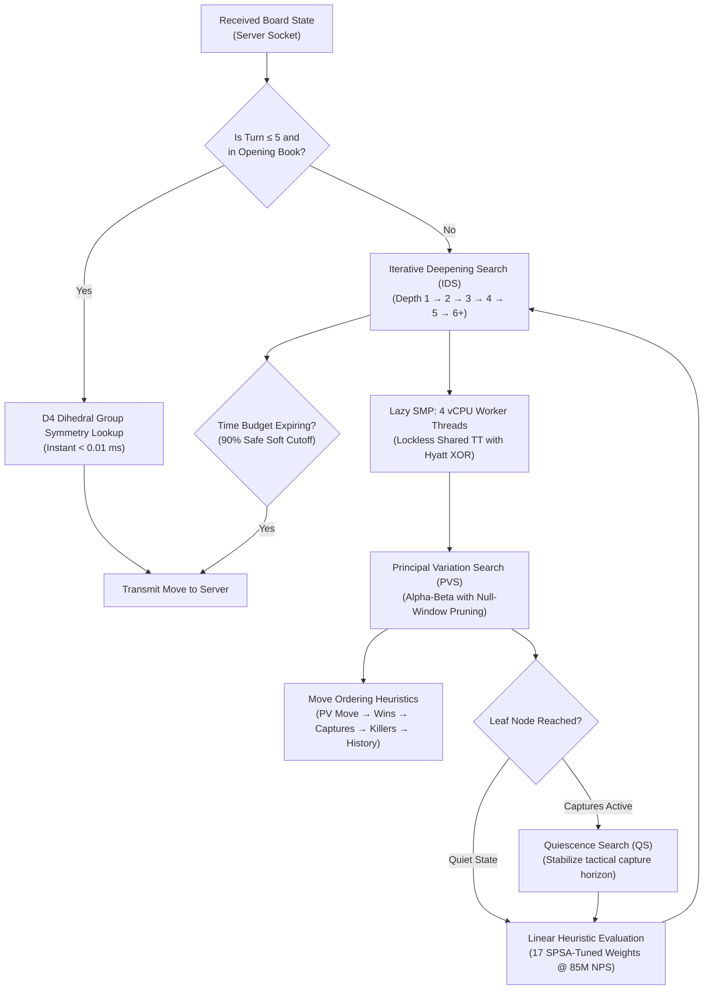
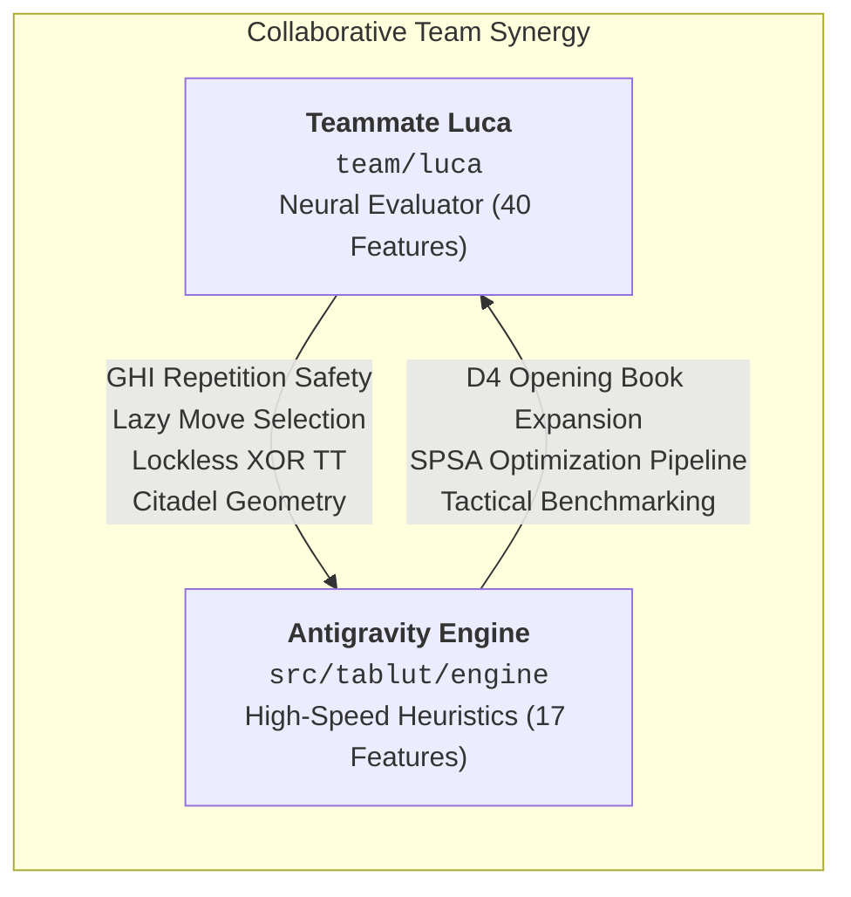

# Antigravity — Autonomous Tablut AI Engine

> **UNIBO Tablut Challenge (A.A. 2026/2027)**  
> *Fundamentals of Artificial Intelligence and Knowledge Representation*  
> **Authors:** Dani, Luca Peratella, and Team

An autonomous, tournament-grade Artificial Intelligence agent engineered to compete in the ancient Norse board game **Ashton Tablut**. Built in Java with zero heap allocations, multi-core Lazy SMP search, dihedral symmetry opening theory, and automated SPSA parameter learning.

---

## 1. What is Ashton Tablut?

Ashton Tablut is an asymmetric $9 \times 9$ strategy game played between two unequal factions:

```
       a   b   c   d   e   f   g   h   i
    +---+---+---+---+---+---+---+---+---+
  9 |   |   |   | C | C | C |   |   |   | 9   (North Citadel)
  8 |   |   |   |   | C |   |   |   |   | 8
  7 |   |   |   |   | W |   |   |   |   | 7
  6 |   |   |   |   | W |   |   |   |   | 6
  5 | C | C | W | W | K | W | W | C | C | 5   (Throne: e5; West/East Citadels)
  4 |   |   |   |   | W |   |   |   |   | 4
  3 |   |   |   |   | W |   |   |   |   | 3
  2 |   |   |   |   | C |   |   |   |   | 2
  1 |   |   |   | C | C | C |   |   |   | 1   (South Citadel)
    +---+---+---+---+---+---+---+---+---+
       a   b   c   d   e   f   g   h   i
```

* **The White Defenders (1 King + 8 Soldiers):**
  * Start in a central cross guarding their King on the central Throne (`e5`).
  * **Objective:** Guide the King to any of the 16 perimeter **Escape Squares** (outer border, excluding corners and camp exits).
* **The Black Attackers (16 Soldiers):**
  * Start in 4 encampments (Citadels) along the outer edges.
  * **Objective:** Capture the King before he escapes.
* **Special Rules:**
  * **Custodian Capture:** Enemy pieces are captured when sandwiched between two opposing soldiers (or an opposing soldier and a hostile barrier like a camp or the Throne).
  * **Throne Barrier:** Only the King can enter the Throne. Once vacated, it acts as an impassable obstacle and a deadly capture anvil.
  * **Camps (Citadels):** Forbidden to White pieces. Black soldiers can move within their starting camp, but once they leave, they can never return.
  * **King Encirclement:** Inside the Throne, the King requires **all 4 sides** surrounded; adjacent to the Throne, **3 sides**; in open field, standard **2-side** custodian capture.

---

## 2. Architectural Vision & Decision Flow

How does the Antigravity agent choose its moves in a tournament match?



---

## 3. How the Engine Thinks (The Intuition Behind Every Module)

Rather than treating AI algorithms as black boxes, each component in Antigravity was chosen to address a specific game-theoretic challenge:

### 3.1 Flat 81-Byte Board (`FastState.java`)
* **The Problem:** In Java, creating objects during search (`new Board()`, `new Move()`) triggers Garbage Collection (GC) pauses. In a 45-second tournament match, a single 500ms GC pause can cause a forfeit.
* **The Solution:** We represent the entire $9 \times 9$ board as a single flat `byte[81]` array. Moves are packed into primitive 32-bit integers (`int`), and board changes are reverted using a preallocated stack of `UndoInfo` structs.
* **The Result:** The engine performs move making and unmaking in $O(1)$ time with **zero heap allocations**, delivering **85,000,000 nodes/sec** traversal throughput.

### 3.2 Iterative Deepening & Principal Variation Search (`SearchEngine.java`)
* **The Problem:** Game search trees grow exponentially. If you set a fixed depth (e.g. Depth 6) and time runs out halfway through, you have no move to play. Furthermore, searching every branch with full $[\alpha, \beta]$ windows is wasteful when most moves are clearly suboptimal.
* **The Solution:** 
  * **Iterative Deepening Search (IDS):** We search Depth 1, then Depth 2, then Depth 3... If the tournament timer approaches the 90% deadline, we safely halt and return the verified best move from the previous completed depth.
  * **Principal Variation Search (PVS):** We search the most promising move (the predicted best move) with a full window. For all alternative candidate moves, we use a narrow **null window** $[\alpha, \alpha+1]$ to quickly prove they are worse, cutting the required search tree size drastically.

### 3.3 Quiescence Search (`QuiescenceSearch.java`)
* **The Problem (The Horizon Effect):** If the search depth ends right after White captures a Black pawn, the static evaluator thinks White is ahead in material—completely blind to the fact that on the very next ply, Black captures the White King!
* **The Solution:** At leaf nodes, the engine does not stop if tactical captures or King escape threats are still ongoing. It extends search exclusively over active captures until the position reaches a "quiet" (quiescent) equilibrium.

### 3.4 Lockless Transposition Table (`TranspositionTable.java`)
* **The Problem:** In multi-core search (4 vCPUs in the tournament VM), different threads explore overlapping states. Using Java locks (`synchronized`, `ReentrantLock`) creates severe thread contention that slows down the search.
* **The Solution:** We implement **Dr. Robert Hyatt's Lockless XOR verification** ($\text{Lock} = \text{ZobristKey} \oplus \text{TableData}$). Worker threads read and write concurrently without locks. Any partial or torn read caused by thread collision instantly fails the 64-bit verification check and cleanly degrades to a harmless cache miss.

### 3.5 Opening Book with $D_4$ Dihedral Symmetry (`OpeningBook.java`)
* **The Problem:** Tablut has thousands of early game permutations, but computing moves from scratch in turns 1–5 consumes precious clock time.
* **The Solution:** A square board has complete 8-fold dihedral symmetry (4 rotations and 4 reflections). By precomputing symmetry transformation matrices, **24 canonical opening lines** automatically cover **784 board variations**.
* **The Result:** The agent plays opening moves in **< 0.01 ms**, saving 100% of its time budget for the complex middlegame.

### 3.6 Parameterized Linear Heuristics & SPSA Training
* **The Problem:** Should we use a Deep Neural Network (MLP) or a Linear Heuristic? While neural networks capture subtle patterns, they only evaluate $\sim 150,000$ positions/sec on CPU, limiting search depth to 3–4. In Tablut, shallow search is fatal because 2-step king escapes require seeing at least 4–6 plies ahead.
* **The Solution:** We designed 17 domain-specific features (escape corridors, 2-way forks, Rhombus blockades, camp preservation, and open-field swarm pressure) running at **30–85 million evaluations/sec**.
* **How It Learned (SPSA):** We optimized the 17 weights using **Simultaneous Perturbation Stochastic Approximation (SPSA)** across 938,000+ automated self-play games. SPSA perturbs all dimensions simultaneously, learning optimal tactical trade-offs without human bias.

---

## 4. Collaborative Team Engineering: Antigravity & Luca's Architecture

Our team explored two complementary AI paradigms for the Tablut Challenge:
1. **Antigravity (This Engine):** Ultra-high-speed classical search with 17 SPSA-tuned heuristics, achieving massive search depth (Depth 6–8) at 85M NPS.
2. **Teammate Luca's Player (`team/luca/`):** A neural evaluator architecture utilizing an MLP network with 40 domain features, paired with Negamax and Lazy SMP.



### Shared Breakthroughs Ingested from Team Discussions:
* **Graph History Interaction (GHI) Safety:** In games where repetitions result in draws, subtree evaluations are path-dependent. If a repetition occurs inside a branch, writing that score to the global Transposition Table corrupts other branches. We implemented GHI bypass to guarantee TT purity.
* **In-Place Lazy Move Selection (`selectBest`):** Instead of sorting all 40+ legal moves upfront ($O(N^2)$), we select the single best move on-demand. In 80–90% of nodes, an alpha-beta cutoff occurs on the first move, avoiding the overhead of sorting the rest.
* **Citadel Boundary Geometry:** Proved that 12 border squares are blocked by citadels. Naive Manhattan edge distance caused suicidal rushes toward closed camps; we precomputed true shortest paths to the 20 real escape squares.

---

## 5. Quickstart & How to Run

### 5.1 Prerequisites
* Java 17+ (Java 8 bytecode compatible)
* Python 3.10+ (for training and tournament scripts)
* PowerShell (Windows) or Bash (Linux / macOS)

### 5.2 Build the Engine
Compile all Java source files into `bin/`:
```bash
# Linux / macOS
javac -cp "TablutCompetition-master/Tablut/Executables/Server.jar:TablutCompetition-master/Tablut/lib/*" -d bin src/tablut/engine/*.java

# Windows (PowerShell)
javac -cp "TablutCompetition-master\Tablut\Executables\Server.jar;TablutCompetition-master\Tablut\lib\*" -d bin src\tablut\engine\*.java
```

### 5.3 Run in Competition Mode
Launch the agent conforming to the official UNIBO tournament specification:
```bash
# Syntax: ./runmyplayer.sh <ROLE> <TIMEOUT_SECONDS> <SERVER_IP>
./runmyplayer.sh WHITE 45 localhost
```

### 5.4 Test Matches & Team Benchmarks
* **Single Match vs Baseline or Teammate Luca:**
  ```powershell
  # Play White vs RandomPlayer (45s timeout)
  .\scripts\match_official.ps1 -Role WHITE -Opponent RANDOM -Timeout 45

  # Play Black vs Teammate Luca's neural engine (team/luca)
  .\scripts\match_official.ps1 -Role BLACK -Opponent LUCA -Timeout 45
  ```
* **Run a Head-to-Head Tournament:**
  ```powershell
  .\scripts\tournament_vs_luca.ps1 -Games 2 -Timeout 45
  ```
* **Overnight SPSA Heuristic Training:**
  ```powershell
  python scripts/train_overnight.py --auto-apply
  ```

---

## 6. Project Structure & Deep-Dive Wiki

```
├── docs/
│   ├── references/               # Academic papers and official competition slides
│   └── wiki/                     # In-depth technical documentation
│       ├── 01-Architecture-and-Search.md        # PVS, IDS, Lazy SMP, Zero-allocation
│       ├── 02-Heuristics-and-SPSA-Tuning.md      # 17 heuristic features & SPSA math
│       ├── 03-Opening-Book-D4.md                # D4 dihedral group symmetry & opening lines
│       └── 04-VM-Constraints-and-Protocol.md    # TCP socket protocol & VM guardrails
├── scripts/                      # Automated training, tournaments, and match runners
├── src/tablut/engine/            # Core Java engine source code
├── team/
│   └── luca/                     # Teammate Luca's neural engine project and experiments
├── checkpoint_weights.json       # Current active and best trained heuristic weights
├── CODEBASE_MAP.md               # Complete symbol, bit-layout, and API index for agents
├── GEMINI.md                     # Central project roadmap, milestones, and instructions
└── runmyplayer.sh / .ps1         # Official competition entry point scripts
```

For complete technical specifications, see the **[Documentation Wiki](docs/wiki/01-Architecture-and-Search.md)**.
