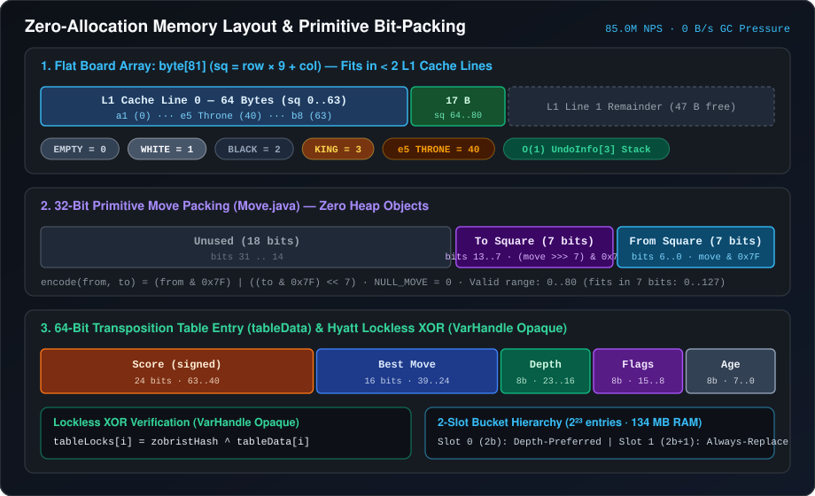
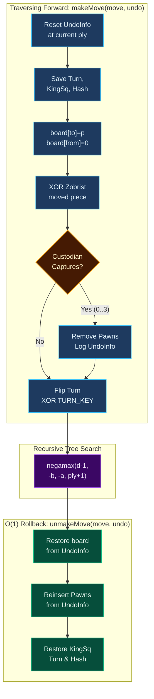

# 01 — State Representation & Bit Architecture

A high-performance board game engine lives or dies by the raw execution speed of its board state operations. In Ashton Tablut, where a minimax tree expansion explores tens of millions of positions per second, any memory allocation or non-contiguous data layout introduces CPU cache misses and JVM garbage collection stalls.

This document details the internal memory layout, primitive packing strategies, stack-allocated undo invariants, Ashton capture routines, and 64-bit incremental Zobrist hashing implemented in `FastState.java`.

---

## 1. Memory Layout: The Flat 81-Byte Array

The engine models the $9 \times 9$ board using a flat, one-dimensional primitive byte array:

```java
public final byte[] board = new byte[81];
```

```
   Index = row * 9 + col

        a(0)  b(1)  c(2)  d(3)  e(4)  f(5)  g(6)  h(7)  i(8)
      +-----+-----+-----+-----+-----+-----+-----+-----+-----+
 8(9) |  72 |  73 |  74 |  75 |  76 |  77 |  78 |  79 |  80 |
 7(8) |  63 |  64 |  65 |  66 |  67 |  68 |  69 |  70 |  71 |
 6(7) |  54 |  55 |  56 |  57 |  58 |  59 |  60 |  61 |  62 |
 5(6) |  45 |  46 |  47 |  48 |  49 |  50 |  51 |  52 |  53 |
 4(5) |  36 |  37 |  38 |  39 |  40 |  41 |  42 |  43 |  44 |  (e5 = 40)
 3(4) |  27 |  28 |  29 |  30 |  31 |  32 |  33 |  34 |  35 |
 2(3) |  18 |  19 |  20 |  21 |  22 |  23 |  24 |  25 |  26 |
 1(2) |   9 |  10 |  11 |  12 |  13 |  14 |  15 |  16 |  17 |
 0(1) |   0 |   1 |   2 |   3 |   4 |   5 |   6 |   7 |   8 |
      +-----+-----+-----+-----+-----+-----+-----+-----+-----+
```

### 1.1 Architectural Trade-Off: Byte Array vs. 128-Bit Bitboards
Standard chess engines rely on 64-bit unsigned integers (`uint64_t` / `long`) to represent $8 \times 8$ boards, running bitwise masks and hardware bit-scans (`popcnt`, `tzcnt`) in single CPU clock cycles. 

Ashton Tablut has 81 squares. A single 64-bit word cannot hold the board. Representing 81 squares requires two 64-bit `long` primitives or a 128-bit SIMD vector. In Java, 128-bit bitboard arithmetic requires manually splitting ray-casts across high and low words:
* Crossing the boundary between square 63 and square 64 introduces extra shifts, masks, and branch instructions.
* Rook-slide ray casts in Tablut terminate on variable conditions: empty squares, occupied squares, the central Throne (`e5`), and 16 citadel squares whose accessibility depends on the piece's initial camp identity.

A flat `byte[81]` array completely avoids split-word boundary masking. Total board memory footprint is exactly 81 bytes. Modern x86-64 processors operate on 64-byte L1 cache lines; the entire board occupies less than two consecutive cache lines (128 bytes). Once brought into L1 cache, indexed array reads (`board[sq]`) incur practically zero latency penalty. This layout clocks **85,048,952 nodes per second** in raw move-generation Perft benchmarks.

### 1.2 Coordinate Mapping & Precomputed Lookup Tables
All geometric calculations avoid run-time arithmetic. `BoardConstants.java` precomputes lookups loaded at JVM initialization:

```java
public static int coord(int r, int c) { return r * 9 + c; }
public static int row(int sq)         { return sq / 9; }
public static int col(int sq)         { return sq % 9; }
```

Key static tables include:
* `IS_CAMP[81]`: Boolean array flagging all 16 camp squares.
* `CAMP_ID[81]`: Maps coordinates to Camp IDs ($0$: North, $1$: South, $2$: West, $3$: East), or $-1$ for normal board squares.
* `IS_ESCAPE[81]`: Flags the 16 official perimeter escape squares.
* `IS_WIN_SQUARE_FOR_KING[81]`: Flags all 20 perimeter target squares (16 escapes + 4 corners).
* `IS_CAMP_ANVIL[81]`: Identifies camp squares that act as hostile capture barriers for White.

---

## 2. 32-Bit Primitive Move Packing

Heap allocations are strictly prohibited inside the search loop. Creating a `new Move(from, to)` object at each branch creates millions of transient allocations per second, triggering JVM garbage collection pauses that result in instant timeout forfeits.

Instead, every move is encoded into a primitive 32-bit `int` (`Move.java`), matching our zero-allocation memory layout alongside `byte[81]` and the 64-bit Transposition Table entry:

<p align="center">
  
</p>

```java
public final class Move {
    public static final int NULL_MOVE = 0;
    private static final int COORD_MASK = 0x7F; // 7 bits can hold values 0..127

    public static int encode(int from, int to) {
        return (from & COORD_MASK) | ((to & COORD_MASK) << 7);
    }

    public static int getFrom(int move) {
        return move & COORD_MASK;
    }

    public static int getTo(int move) {
        return (move >>> 7) & COORD_MASK;
    }
}
```

Bitwise masking and shifting extract origins and destinations with zero memory allocation.

---

## 3. Zero-Allocation Make / Unmake Cycle

Tree search traverses down branches by mutating the state in-place, then unwinds mutations upon returning. Copying the entire 81-byte board state before every recursive call consumes unnecessary memory bandwidth.

The engine uses an in-place mutation and rollback model orchestrated by `UndoInfo.java`.

### 3.1 Stack-Allocated `UndoInfo` Struct
Each search ply maintains a preallocated `UndoInfo` instance on a search stack. The struct captures every delta required to revert board state back to its exact pre-move condition:

```java
public final class UndoInfo {
    public int capturedCount;
    public final int[] capturedSquares = new int[3];
    public final byte[] capturedPieces = new byte[3];
    public byte oldKingSquare;
    public byte oldTurn;
    public long oldZobristHash;

    public void reset() {
        this.capturedCount = 0;
    }

    public void addCapture(int sq, byte piece) {
        capturedSquares[capturedCount] = sq;
        capturedPieces[capturedCount] = piece;
        capturedCount++;
    }
}
```

A single orthogonal move in Ashton Tablut can capture at most 3 enemy pieces simultaneously (one along the movement ray and two laterally against perpendicular anvils). An array size of 3 covers all legal board configurations without dynamic reallocation.



---

## 4. Ashton Capture Rules & Barrier Anvils

Capturing in Tablut is active and custodian: a piece must be sandwiched between two hostile entities as the direct result of a move. Moving voluntarily between two opposing pieces is completely safe.

### 4.1 Hostile Barriers: Citadels and Throne
Squares other than pieces can act as capture anvils:
* **The Empty Throne (`e5`):** Acts as a hostile capture barrier for both White and Black. A White soldier can capture a Black soldier by pinning it against the empty Throne. A Black soldier can capture a White soldier in the exact same manner.
* **The Citadels (Camps):** All 16 camp squares act as capture anvils for Black. For White, however, Ashton rules specify an asymmetry: the four camp entry points (`a5, i5, e1, e9`) do not act as anvils for White captures. White can only use non-entrance camp squares (`IS_CAMP_ANVIL[sq] == true`) to sandwich Black pieces.

### 4.2 King Capture Mechanics
Capturing the King depends strictly on his board position:

1. **On the Throne (`e5`):**
   The King is defended by the castle walls. Black must occupy all 4 orthogonal squares (`e6, e4, d5, f5`) to execute the capture.
2. **Adjacent to the Throne (`e4, e6, d5, f5`):**
   The Throne acts as a hostile barrier. Black must surround the King on all **3 remaining orthogonal sides**.
3. **In the Open Field:**
   The King loses his fortress protection. He is captured like a standard soldier via 2-sided custodian capture between two Black soldiers, or between one Black soldier and a hostile barrier (Throne or Camp).

```java
// Open field capture check excerpt from FastState.java
int opp1 = to + step;
int opp2 = to + 2 * step;
if (board[opp1] == WHITE && (board[opp2] == BLACK || isHostileBarrierForBlack(opp2))) {
    board[opp1] = EMPTY;
    undo.addCapture(opp1, WHITE);
    whiteCount--;
}
```

---

## 5. 64-Bit Incremental Zobrist Hashing

Cycle detection, transposition lookups, and repetition checks require a compact, unique representation of the board state. Calculating a hash from scratch at every node wastes clock cycles.

The engine maintains a 64-bit Zobrist hash updated incrementally via XOR operations (`^`).

### 5.1 Key Initialization & Layout
At startup, `ZobristHash.java` initializes pseudorandom 64-bit keys using a deterministic linear congruential generator initialized with seed `0x5441424C55544149L` (`"TABLUTAI"`):

```java
public static final long[][] PIECE_KEYS = new long[81][4];
public static final long BLACK_TURN_KEY;
```

* `PIECE_KEYS[sq][piece]`: Unique 64-bit integer for every piece type (`EMPTY=0`, `WHITE=1`, `BLACK=2`, `KING=3`) at every square ($0 \dots 80$).
* `BLACK_TURN_KEY`: A single 64-bit value toggled when Black holds the initiative.

### 5.2 $O(1)$ Incremental Updates
When a piece moves from square $u$ to square $v$, the hash is updated with three XOR operations:

$$
\text{Hash}' = \text{Hash} \oplus \text{Key}(P, u) \oplus \text{Key}(P, v) \oplus \text{BlackTurnKey}
$$

If the move captures an enemy pawn at square $c$:

$$\text{Hash}'' = \text{Hash}' \oplus \text{Key}(P_{\text{captured}}, c)$$

Because $X \oplus K \oplus K = X$, unmaking a move applies the identical XOR sequence in reverse, restoring the previous 64-bit hash in $O(1)$ time without reading the 81-byte board array.
