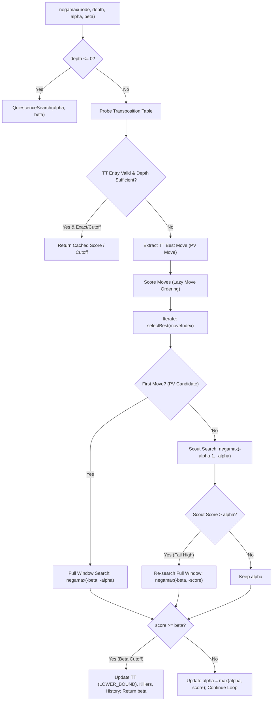

# 02 — Search & Pruning Algorithms

Tree traversal efficiency dictates competitive strength. Searching an Ashton Tablut game tree is particularly challenging due to an asymmetric branching factor ranging from 30 to over 60 legal moves per position. An unpruned minimax tree grows exponentially, making depth 5 unreachable within reasonable time limits.

This document details the core search algorithms, pruning techniques, and move ordering heuristics implemented in `SearchEngine.java`, `MoveOrderer.java`, and `QuiescenceSearch.java`.

---

## 1. Core Search: Negamax with Alpha-Beta & Iterative Deepening

The engine implements a zero-sum Negamax framework with $\alpha$-$\beta$ pruning. Because White and Black have opposing objectives (White maximizes the score, Black minimizes it), Negamax expresses both perspectives via score inversion:

$$\text{negamax}(S, \alpha, \beta) = \max_{m \in \text{Moves}} \left( -\text{negamax}(S', -\beta, -\alpha) \right)$$

### 1.1 Distance-to-Mate Scoring
Terminal states are scored based on their distance from the search root:

```java
public static final int WIN_SCORE = 100_000;

// Terminal score assignment at search ply
int score = (winner == myTurn) ? (WIN_SCORE - ply) : (-WIN_SCORE + ply);
```

Subtracting `ply` from winning scores ensures the engine selects the shortest path to victory. Adding `ply` to losing scores incentivizes delaying an unavoidable loss for as many plies as possible, creating opportunities for the opponent to make a tactical error.

### 1.2 Iterative Deepening Search (IDS)
A competitive agent operating under strict time constraints cannot execute a fixed-depth search: a sudden timeout would discard all computations for the current depth. 

Iterative Deepening Search executes consecutive depth passes: $d = 1, 2, 3, \dots, D_{\max}$. If time runs out during depth $d$, the engine immediately aborts and returns the best move verified at depth $d-1$. Furthermore, Iterative Deepening seeds the Transposition Table and Move Orderer with high-quality candidate moves from earlier iterations, accelerating subsequent $\alpha$-$\beta$ cutoffs.

---

## 2. Advanced Tactical Pruning & Search Extensions



### 2.1 Principal Variation Search (PVS / NegaScout)
At interior tree nodes with well-ordered moves, the first move evaluated is very likely to be the best move. PVS exploits this property by searching the first candidate with the full aspiration window $[\alpha, \beta]$. All subsequent moves are tested with a minimal null-window (zero-width window) $[-\alpha - 1, -\alpha]$ to prove they cannot beat $\alpha$:

```java
if (moveCount == 0) {
    // First move: full window search
    score = -negamax(depth - 1, -beta, -alpha, ply + 1);
} else {
    // Null-window scout search
    score = -negamax(depth - 1, -alpha - 1, -alpha, ply + 1);
    
    // If the scout fails high, re-search with the full window
    if (score > alpha && score < beta) {
        score = -negamax(depth - 1, -beta, -score, ply + 1);
    }
}
```

Because zero-width windows cause immediate cutoffs without exploring alternate branches, PVS eliminates large portions of the sub-tree. In benchmark comparisons at depth 5, PVS reduced total explored nodes by **7.7%** and reduced total search time by **31.7%**.

### 2.2 Aspiration Windows
For depths $d \ge 4$, rather than starting the root search with $[-\infty, +\infty]$, the engine initializes the search window around the score obtained from the previous depth $S_{d-1}$:

$$[\alpha, \beta] = [S_{d-1} - \Delta, S_{d-1} + \Delta], \quad \Delta = 120 \text{ centipawns}$$

If the search score stays within bounds, pruning efficiency improves significantly. If a fail-low ($\le \alpha$) or fail-high ($\ge \beta$) occurs, the window is expanded back to $[-\infty, +\infty]$ for a full re-search.

### 2.3 Quiescence Search & Tactical Safeguards
Evaluating leaf nodes statically triggers the **Horizon Effect**: an engine might evaluate a board position right before an inevitable counter-capture, falsely assessing a material advantage.

`QuiescenceSearch.java` resolves this by extending the search beyond depth 0, strictly examining tactical moves (captures and King escape threats) up to a safety depth of 6 plies:

1. **Stand-Pat Cutoff:** The static evaluation represents a baseline lower bound. If $\text{standPat} \ge \beta$, the node fails high immediately: the opponent would not allow this line.
2. **Delta Pruning:** If $\text{standPat} + \text{DELTA\_MARGIN} < \alpha$ (with $\text{DELTA\_MARGIN} = 400$), even capturing an opponent soldier cannot raise the score above $\alpha$. The branch is discarded.
3. **Tactical Bypass:** Delta Pruning is strictly bypassed whenever:
   * The King is within 2 steps of an escape square (`MIN_DISTANCE_TO_ESCAPE[kingSq] <= 2`).
   * The King is under active capture threat (`isKingThreatened == true`).
   Bypassing Delta Pruning in these scenarios prevents the search from pruning subtle, non-capture king maneuvers that lead directly to victory or defeat.

---

## 3. The Move Ordering Cascade

The efficiency of $\alpha$-$\beta$ pruning depends entirely on move ordering. In the theoretical best case where the strongest move is evaluated first, $\alpha$-$\beta$ reduces the effective branching factor from $b$ to $\sqrt{b}$, doubling the reachable search depth.

`MoveOrderer.java` scores and sorts candidate moves across five hierarchical tiers:

| Tier | Move Classification | Score Weight | Description |
| :---: | :--- | :--- | :--- |
| **1** | **Transposition Table Move** | `1,000,000` | Best move stored from a prior shallow search or PV node |
| **2** | **Winning Moves** | `900,000` | Immediate King escape to perimeter or King capture |
| **3** | **Custodian Captures** | `500,000 + 100,000 * count` | Capturing 1, 2, or 3 opponent soldiers |
| **4** | **Killer Moves** | `100,000` / `80,000` | Quiet moves that triggered $\beta$-cutoffs at the same ply |
| **5** | **History Heuristic** | $0 \dots 50,000$ | Table tracking successful cutoff frequency: `history[from][to] += depth * depth` |

### 3.1 On-Demand Lazy Move Selection
Sorting 30 to 60 moves upfront with an $O(N \log N)$ or $O(N^2)$ algorithm wastes clock cycles at cut-nodes, where the very first move triggers a $\beta$-cutoff over 80% of the time.

The engine uses on-demand lazy selection (`selectBest`):
1. `scoreMoves()` calculates priority scores for all moves in a single linear pass $O(N)$.
2. Instead of sorting the whole array, the search loop calls `selectBest(moveIndex)`, which scans the remaining unsorted elements, identifies the highest-scoring move, and swaps it into position `moveIndex`.

If move 0 or 1 causes a cutoff, the remaining 40+ candidate moves are never sorted, eliminating over 90% of move-ordering overhead at cut-nodes.

---

## 4. Two-Fold Repetition & Graph History Interaction (GHI)

According to Ashton Tablut tournament rules, repeating the exact same board position **twice** results in an immediate draw.

### 4.1 Game History vs. Search Path
The engine tracks state history on two distinct levels:
* `gameHistory[]`: Board hashes from real match turns played on the referee server.
* `searchPath[]`: Board hashes generated along the active search branch from the root to the current ply.

If the current state's Zobrist hash matches an entry in `gameHistory` or an ancestor state in `searchPath`, the evaluation returns `DRAW_SCORE = 0`.

### 4.2 GHI Transposition Safety
Graph History Interaction (GHI) occurs when a position can be reached via multiple distinct transposition paths, one of which contains a repetition while another does not. 

If a search node evaluates to a draw due to a cyclic repetition along its current search branch, storing that `0.0` score into the global Transposition Table would poison the cache: subsequent probes from non-cyclic paths would mistakenly evaluate the position as a forced draw.

To guarantee correctness, `SearchEngine.java` maintains a `repetitionEventCounter`. If a repetition occurs within a subtree, the engine flags the evaluation as path-dependent and **bypasses storing the result into the Transposition Table**, maintaining absolute cache integrity.
