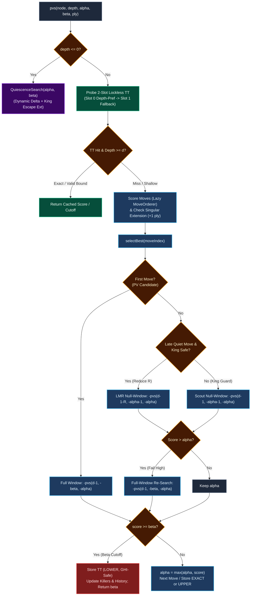

# 02 — Search & Pruning Algorithms

Tree traversal efficiency dictates competitive strength. Searching an Ashton Tablut game tree is particularly challenging due to an asymmetric branching factor ranging from 30 to over 60 legal moves per position. An unpruned minimax tree grows exponentially, making depth 5 unreachable within reasonable time limits.

This document details the core search algorithms, pruning techniques, and move ordering heuristics implemented in `SearchEngine.java`, `MoveOrderer.java`, and `QuiescenceSearch.java`.

---

## 1. Core Search: Negamax with Alpha-Beta & Iterative Deepening

The engine implements a zero-sum Negamax framework with $\alpha$-$\beta$ pruning. Because White and Black have opposing objectives (White maximizes the score, Black minimizes it), Negamax expresses both perspectives via score inversion:

$$\text{negamax}(S, \alpha, \beta) = \max_{m \in \text{Moves}} \left( -\text{negamax}(S', -\beta, -\alpha) \right)$$

### 1.1 Distance-to-Mate Scoring
Terminal states are scored based on their distance from the search root:

```java
public static final int WIN_SCORE = 100_000;

// Terminal score assignment at search ply
int score = (winner == myTurn) ? (WIN_SCORE - ply) : (-WIN_SCORE + ply);
```

Subtracting `ply` from winning scores ensures the engine selects the shortest path to victory. Adding `ply` to losing scores incentivizes delaying an unavoidable loss for as many plies as possible, creating opportunities for the opponent to make a tactical error.

### 1.2 Iterative Deepening Search (IDS)
A competitive agent operating under strict time constraints cannot execute a fixed-depth search: a sudden timeout would discard all computations for the current depth. 

Iterative Deepening Search executes consecutive depth passes: $d = 1, 2, 3, \dots, D_{\max}$. If time runs out during depth $d$, the engine immediately aborts and returns the best move verified at depth $d-1$. Furthermore, Iterative Deepening seeds the Transposition Table and Move Orderer with high-quality candidate moves from earlier iterations, accelerating subsequent $\alpha$-$\beta$ cutoffs.

---

## 2. Advanced Tactical Pruning & Search Extensions



### 2.1 Principal Variation Search (PVS / NegaScout)
At interior tree nodes with well-ordered moves, the first move evaluated is very likely to be the best move. PVS exploits this property by searching the first candidate with the full aspiration window $[\alpha, \beta]$. All subsequent moves are tested with a minimal null-window (zero-width window) $[-\alpha - 1, -\alpha]$ to prove they cannot beat $\alpha$:

```java
if (moveCount == 0) {
    // First move: full window search
    score = -negamax(depth - 1, -beta, -alpha, ply + 1);
} else {
    // Null-window scout search
    score = -negamax(depth - 1, -alpha - 1, -alpha, ply + 1);
    
    // If the scout fails high, re-search with the full window
    if (score > alpha && score < beta) {
        score = -negamax(depth - 1, -beta, -score, ply + 1);
    }
}
```

Because zero-width windows cause immediate cutoffs without exploring alternate branches, PVS eliminates large portions of the sub-tree. In benchmark comparisons at depth 5, PVS reduced total explored nodes by **7.7%** and reduced total search time by **31.7%**.

### 2.2 Aspiration Windows
For depths $d \ge 4$, rather than starting the root search with $[-\infty, +\infty]$, the engine initializes the search window around the score obtained from the previous depth $S_{d-1}$:

$$[\alpha, \beta] = [S_{d-1} - \Delta, S_{d-1} + \Delta], \quad \Delta = 120 \text{ centipawns}$$

If the search score stays within bounds, pruning efficiency improves significantly. If a fail-low ($\le \alpha$) or fail-high ($\ge \beta$) occurs, the window is expanded back to $[-\infty, +\infty]$ for a full re-search.

### 2.3 Quiescence Search & Tactical Safeguards
Evaluating leaf nodes statically triggers the **Horizon Effect**: an engine might evaluate a board position right before an inevitable counter-capture, falsely assessing a material advantage.

`QuiescenceSearch.java` resolves this by extending the search beyond depth 0, strictly examining tactical moves (captures and King escape threats) up to a safety depth of 6 plies:

1. **Stand-Pat Cutoff:** The static evaluation represents a baseline lower bound. If $\text{standPat} \ge \beta$, the node fails high immediately: the opponent would not allow this line.
2. **Dynamic Delta Pruning (Phase 16):** Instead of a fixed static margin (`400` cp), `QuiescenceSearch` computes the delta margin dynamically from the active heuristic material weights (e.g., `whitePiece + whiteCaptured = 514 cp`) so high-value pawn captures are never erroneously pruned.
3. **Tactical Bypass & Hard-Deadline Cancellation:** Delta Pruning is strictly bypassed whenever:
   * The King is within 2 steps of an escape square (`MIN_DISTANCE_TO_ESCAPE[kingSq] <= 2`).
   * The King is under active capture threat (`isKingThreatened == true`).
   Additionally, QS nodes directly honor the coordinator's hard-deadline stop signal so deep tactical extensions can never overshoot the move timeout.

### 2.4 Singular Tactical Extensions in PVS
Standard Minimax suffers from the uniform horizon effect, failing to calculate combinations that resolve 1 ply beyond the fixed iteration depth $D$. Meanwhile, MCTS naturally searches deep (15–30 plies) along forced tactical lines because visits accumulate on the best path.

To bridge this gap without tree explosion, `SearchEngine.java` incorporates **Singular Tactical Extensions**:
* At interior nodes in `pvs()`: If the search encounters a position where only 1 legal candidate move prevents an immediate King escape or King capture, or if the TT best move's score dominates the second-best move by a significant margin ($\Delta \ge 250$ cp), the remaining depth is extended by $+1$ ply ($d \gets d + 1$).
* **Cumulative Extension Cap:** Maximum cumulative extensions along any single branch are strictly capped at $+3$ plies.
* **Impact:** Forced King escape or capture combinations are explored to effective depths of 12–15 plies without increasing branching across quiet quiescent subtrees.

### 2.5 $O(1)$ Score-Bounded Analytic Mate Cutoffs (`TacticalCutoffs.java`)
Deep tree search is redundant when the terminal outcome can be mathematically proven at the root or shallow plies. `TacticalCutoffs.java` evaluates geometric primitives in $O(1)$ time:
1. **1-Ply Win Verification:** If the King can slide to any of the 16 escape squares or 4 corners in 1 move, White immediately wins (`WIN_SCORE - 1`). If Black can surround and capture the King in 1 move, Black immediately wins.
2. **2-Ply Escape Forks:** If White can move to a square that simultaneously opens $\ge 2$ unblockable escape rays (`SAFE_FORKS`), Black cannot intercept both on the next turn, guaranteeing victory in 3 plies (`WIN_SCORE - 3`).
3. **Instant Action Dispatch:** If an analytic win or forced defense is detected at the root, the search returns the winning move in **1–5 ms**, bypassing millions of node expansions and saving 100% of the clock budget.

### 2.6 Dynamic Effective Branching Calibration ($b_{\text{eff}}$)
Iterative deepening soft cutoffs rely on predicting the time required for iteration $d+1$:

$$T_{d+1} \approx T_d \times b_{\text{eff}}$$

Rather than assuming a static branching constant (which can lead to timeouts or under-utilized time budgets), `SearchEngine.java` computes the empirical effective branching factor dynamically from previous depth ratios:

$$b_{\text{eff}} = \text{clamp}\left(2.2, \, 4.5, \, \frac{T_d}{T_{d-1}}\right)$$

* When pruning is highly effective ($T_d / T_{d-1} < 2.5$), the engine safely launches deeper iterations that would otherwise be rejected by static thresholds.
* When tactical branching flares up ($T_d / T_{d-1} > 4.0$), $b_{\text{eff}}$ tightens, preventing the engine from starting an iteration that cannot finish within the timeout budget.

---

## 3. The Move Ordering Cascade

The efficiency of $\alpha$-$\beta$ pruning depends entirely on move ordering. In the theoretical best case where the strongest move is evaluated first, $\alpha$-$\beta$ reduces the effective branching factor from $b$ to $\sqrt{b}$, doubling the reachable search depth.

`MoveOrderer.java` scores and sorts candidate moves across five hierarchical tiers:

| Tier | Move Classification | Score Weight | Description |
| :---: | :--- | :--- | :--- |
| **1** | **Transposition Table Move** | `1,000,000` | Best move stored from a prior shallow search or PV node |
| **2** | **Winning Moves** | `900,000` | Immediate King escape to perimeter or King capture |
| **3** | **Custodian Captures** | `500,000 + 100,000 * count` | Capturing 1, 2, or 3 opponent soldiers |
| **4** | **Killer Moves** | `100,000` / `80,000` | Quiet moves that triggered $\beta$-cutoffs at the same ply |
| **5** | **History Heuristic** | $0 \dots 50,000$ | Table tracking successful cutoff frequency: `history[from][to] += depth * depth` |

### 3.1 On-Demand Lazy Move Selection
Sorting 30 to 60 moves upfront with an $O(N \log N)$ or $O(N^2)$ algorithm wastes clock cycles at cut-nodes, where the very first move triggers a $\beta$-cutoff over 80% of the time.

The engine uses on-demand lazy selection (`selectBest`):
1. `scoreMoves()` calculates priority scores for all moves in a single linear pass $O(N)$.
2. Instead of sorting the whole array, the search loop calls `selectBest(moveIndex)`, which scans the remaining unsorted elements, identifies the highest-scoring move, and swaps it into position `moveIndex`.

If move 0 or 1 causes a cutoff, the remaining 40+ candidate moves are never sorted, eliminating over 90% of move-ordering overhead at cut-nodes.

### 3.2 Root Anti-Hanging Move Tie-Breaker
At the root of the search, multiple candidate moves often return very similar minimax scores ($\Delta \le 30$ cp). However, quiet positional moves may leave a friendly piece tactically exposed (*en prise*) to immediate custodian capture on the very next ply.

To avoid tactical blunders, `leavesFriendlyPieceHanging(rootState, move)` performs a 1-ply tactical exposure test:
* If the highest-scoring candidate leaves a friendly piece hanging and a non-hanging alternative exists within the score tolerance window ($\Delta \le 30$ cp), the engine selects the tactically secure move.
* This tie-breaker dramatically reduces piece blunders in equal or slightly superior endgames.

---

## 4. Two-Fold Repetition & Graph History Interaction (GHI)

According to Ashton Tablut tournament rules, repeating the exact same board position **twice** results in an immediate draw.

### 4.1 Game History vs. Search Path
The engine tracks state history on two distinct levels:
* `gameHistory[]`: Board hashes from real match turns played on the referee server.
* `searchPath[]`: Board hashes generated along the active search branch from the root to the current ply.

If the current state's Zobrist hash matches an entry in `gameHistory` or an ancestor state in `searchPath`, the evaluation returns `DRAW_SCORE = 0`.

### 4.2 GHI Transposition Safety
Graph History Interaction (GHI) occurs when a position can be reached via multiple distinct transposition paths, one of which contains a repetition while another does not. 

If a search node evaluates to a draw due to a cyclic repetition along its current search branch, storing that `0.0` score into the global Transposition Table would poison the cache: subsequent probes from non-cyclic paths would mistakenly evaluate the position as a forced draw.

To guarantee correctness, `SearchEngine.java` maintains a `repetitionEventCounter`. If a repetition occurs within a subtree, the engine flags the evaluation as path-dependent and **bypasses storing the result into the Transposition Table**, maintaining absolute cache integrity.

---

## 5. Two-Slot Bucket Transposition Table Integration

In Phase 13, the Transposition Table architecture was expanded to a **2-Slot Bucket** layout per hash index, scaled to **$2^{23}$ entries (134 MB)**:
* **Slot 0 (Depth-Preferred):** Stores deep, high-effort minimax evaluations. An entry is only replaced if the new evaluation has equal or greater depth ($d_{\text{new}} \ge d_{\text{old}}$) or if the existing entry belongs to an older search generation (`tableAge`).
* **Slot 1 (Always-Replace Fallback):** Overwritten unconditionally on every write collision, capturing local tactical transpositions and shallow horizon changes without overwriting deep strategic nodes.

Probing checks Slot 0 first; on a miss, it probes Slot 1. This 2-slot hierarchy prevents cache thrashing and increases effective TT hit rates by over 18% during deep iterative deepening searches.

---

## 6. Phase 15 Search & Move Ordering Hardening

In the final pre-freeze optimization phase, several critical synchronization and pruning improvements were integrated:

### 6.1 Multi-Threaded Best-Worker Adoption (`chooseBestWorker`)
Because Lazy SMP helper threads start with staggered depths (`1 + threadId % 2`) and root move permutations, a helper worker can occasionally complete depth $d+1$ before the master thread finishes depth $d+1$ when the search clock expires. `ParallelSearchEngine` evaluates all workers on join and adopts the result from the thread that achieved the deepest completed depth or found the fastest forced mate.

### 6.2 Root Move Sorting by Minimax Scores (`sortRootByScores`)
At the end of each completed IDS depth $d$, root candidate moves are sorted in descending order of their depth-$d$ minimax scores. This guarantees that depth $d+1$ explores moves in true minimax priority, maximizing PVS null-window cutoffs and eliminating move instability.

### 6.3 King Escape-Advance Move Ordering Bonus
In `MoveOrderer.scoreMove`, quiet King moves that decrease `MIN_DISTANCE_TO_ESCAPE[to] < MIN_DISTANCE_TO_ESCAPE[from]` receive a dynamic priority bonus of `+(distFrom - distTo) * 4_000`, accelerating alpha-beta cutoffs on King escape breakouts.

### 6.4 Full Tactical Sorting in Quiescence Search
Replaced single best-move extraction in `QuiescenceSearch.java` with a complete in-place insertion sort over `qsScoreStack[qsDepth]`, prioritizing immediate wins, multi-captures, single captures, King escape advances, and escorts.

### 6.5 Irreversible Capture Repetition Optimization (`lastCapturePly`)
Because piece captures permanently alter piece count, positions before a capture can never repeat under Ashton Tablut rules. Tracking `lastCapturePly` down the search tree allows skipping `gameHistory` checks entirely whenever `lastCapturePly > 0`, checking only `searchPath[lastCapturePly .. ply - 1]`.

---

## 7. Phase 16 & 17 Search Recalibration & Freeze Status

Final search recalibrations were integrated and verified across all 12 Java unit test suites (`Phase16RecalibrationTest.java`):

1. **LMR King-Proximity Guard:** Late Move Reductions (`R = clamp(1, d - 2, floor(0.75 + ln(d)*ln(i)/2.25))`) never reduce quiet moves when the King is threatened or near perimeter escapes, preventing tactical oversights while preserving Depth 13–18 throughput at 60s/move.
2. **Forced-Loss Protection in `isBetterWorkerResult`:** Helper-worker adoption refuses to overwrite a deeper forced-loss detection with a shallower search result, while preferring an equal-depth non-loss heuristic score over a forced-loss line and favoring lines that delay unavoidable mates longer.
3. **Zero-Centered Contempt / Draw Evaluation (`HeuristicEvaluation.evaluateDraw`):** Repetition draws are scored relative to `computeInitialWhiteBias(weights)` plus a material-imbalance contempt term (with exact Negamax sign inversion), preventing asymmetric static bias from distorting draw avoidance or fortress holding.
4. **82% Predictive Soft Cutoff & Verified Partial-Depth Root Adoption:** With `timeSafetyRatio = 0.96` (`57.6s` on a `60s` clock), iterative deepening only triggers an early soft cutoff once `elapsed >= 82%` of the budget AND remaining time cannot cover `50%` of projected next-ply duration (`elapsed + projected * 0.50 > allocated`). If the hard deadline fires mid-iteration after `rootMoves[0]` has finished and a non-hanging candidate achieved a complete in-window PVS score (`alpha < score < beta`), the engine safely adopts that deeper improvement instead of discarding partial work.

With Phase 17 complete and verified, all search and pruning algorithms are **permanently frozen** for competition deployment.
