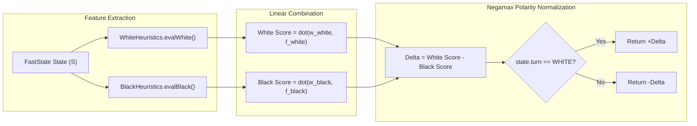

# 03 — Heuristics & Domain Knowledge

Evaluating non-terminal leaf positions in Ashton Tablut cannot rely on symmetric material counting. The sides have fundamentally different victory conditions, piece counts, and structural goals. White commands 9 pieces (including the King) and seeks escape routes; Black commands 16 pieces and seeks territorial containment and encirclement.

This document details the mathematical formulation, geometric feature extractors, and domain weights implemented across `HeuristicEvaluation.java`, `WhiteHeuristics.java`, `BlackHeuristics.java`, and `HeuristicWeights.java`.

---

## 1. Asymmetric Game Strategy

The heuristic engine evaluates the board through two competing domain models:

* **The White Defender Model:**
  White's tactical imperative is opening escape rays. Moving the King closer to the perimeter while clearing cross-guards creates multiple simultaneous escape corridors. If White creates two independent escape paths (a double-threat fork), Black cannot block both in a single turn, guaranteeing a White victory.
* **The Black Attacker Model:**
  Black's tactical imperative is perimeter containment. Rushing the King directly often creates tactical weaknesses that White can exploit. Instead, Black maintains an outer cordon: keeping the camp doorway soldiers in place, establishing an 8-point Rhombus ring, linking soldiers into connected chains, and constricting the King's mobility through an attractive swarm gradient.

---

## 2. Complete Parameterized Heuristic Terms (17 Weights)

The heuristic engine evaluates 17 parameterized terms stored in `HeuristicWeights.java`:

### 2.1 White Evaluation Terms (`WhiteHeuristics.java`)

| Parameter | Default Weight | Description & Algorithmic Formulation |
| :--- | :---: | :--- |
| `whitePiece` | `125` | Value per active White defender on the board. |
| `blackCaptured` | `96` | Bonus per eliminated Black attacker ($16 - \text{blackCount}$). |
| `kingDistance` | `30` | Penalty per step between the King and the nearest perimeter escape square: `MIN_DISTANCE_TO_ESCAPE[kingSq] * kingDistance`. |
| `kingSingleEscape` | `1446` | Bonus awarded when the King has exactly 1 unblocked orthogonal ray to a perimeter escape square. |
| `kingDoubleEscape` | `18413` | Massive decisive bonus awarded when the King possesses $\ge 2$ unblocked escape rays (an unstoppable fork). |
| `diamondOccupancy` | `65` | Bonus for White soldiers occupying central diamond formations ($D_1$: `d3, f4, d6, f7`; $D_2$: `f3, d4, f6, d7`), securing safe transit routes around the Throne. |
| `kingMobility` | `15` | Bonus per legal orthogonal square the King can slide to from his current position. |
| `kingVulnerabilityPenalty` | `219` | Penalty incurred when the King is adjacent to hostile entities without safe counter-protection, scaling up sharply (+4) if pinned against citadel anvil borders. |

### 2.2 Black Evaluation Terms (`BlackHeuristics.java`)

| Parameter | Default Weight | Description & Algorithmic Formulation |
| :--- | :---: | :--- |
| `blackPiece` | `105` | Value per active Black attacker on the board. |
| `whiteCaptured` | `194` | Bonus per eliminated White defender ($8 - \text{whiteCount}$). Reflects Black's attrition strategy: eliminating White pawns degrades White's escape shielding. |
| `rhombusBlockade` | `88` | Bonus per Black soldier occupying the 8-point Rhombus ring (`c2, g2, b3, h3, b7, h7, c8, g8`). |
| `campFrontPreserved` | `61` | Bonus per preserved camp doorway square (`e2, e8, b5, h5`). Prevents Black pieces from abandoning camp choke points prematurely. |
| `kingSurroundedThrone` | `235` | Bonus per hostile flanker surrounding the King while he is on or adjacent to the Throne. |
| `kingContainment` | `38` | Positional bonus rewarding Black for confining the King near the center of the board. |
| `blackMobility` | `7` | Bonus per legal sliding move available across all active Black soldiers. |
| `blackConnectedChains` | `12` | Bonus per adjacent pair of Black soldiers (orthogonal and diagonal links), incentivizing cohesive defensive walls. |
| `kingOpenFieldContainment` | `18` | Swarm bonus attracting Black soldiers toward the King once the King escapes into the open field ($d(\text{King}, \text{Throne}) \ge 2$). |

---

## 3. Deep Architectural Features

### 3.1 Strict 20-Exit Geometry vs. Ghost Citadels
Early implementations suffered from a critical geometric bug: measuring King escape distance to the outer board perimeter indiscriminately. The perimeter has 36 squares:
* 16 valid escape squares.
* 4 corner squares (which also count as winning squares for the King).
* 16 citadel / camp squares (where White pieces can **never** step).

Measuring distance to the generic board perimeter caused the King to navigate directly toward enemy camps, treating them as valid escape exits. 

`BoardConstants.java` corrects this with a precomputed lookup array `MIN_DISTANCE_TO_ESCAPE[81]` that measures shortest Manhattan distances strictly to the 20 legal winning squares (16 escapes + 4 corners).

### 3.2 The 8-Point Rhombus Blockade
The optimal perimeter blockade for Black forms an 8-point ring (the Ashton Rhombus):

```
       a   b   c   d   e   f   g   h   i
    +---+---+---+---+---+---+---+---+---+
  9 |   |   |   | C | C | C |   |   |   | 9
  8 |   |   | R |   | C |   | R |   |   | 8  (c8, g8)
  7 |   | R |   |   |   |   |   | R |   | 7  (b7, h7)
  6 |   |   |   |   |   |   |   |   |   | 6
  5 | C | C |   |   | T |   |   | C | C | 5  (Throne: e5)
  4 |   |   |   |   |   |   |   |   |   | 4
  3 |   | R |   |   |   |   |   | R |   | 3  (b3, h3)
  2 |   |   | R |   | C |   | R |   |   | 2  (c2, g2)
  1 |   |   |   | C | C | C |   |   |   | 1
    +---+---+---+---+---+---+---+---+---+
       a   b   c   d   e   f   g   h   i
```

Occupying squares `c2, g2, b3, h3, b7, h7, c8, g8` intercepts all diagonal and orthogonal escape rays radiating from the central castle before the King can reach the perimeter. `BlackHeuristics.java` evaluates occupancy of these 8 key squares, penalizing Black whenever a soldier breaks the ring unnecessarily.

### 3.3 Dynamic Swarm Gradient (Open-Field Containment)
When the King vacates the central $3 \times 3$ fortress ($d(\text{King}, \text{Throne}) \ge 2$), traditional throne-encirclement heuristics lose their relevance.

`computeOpenFieldContainment` scans all active Black pieces within 4 Manhattan steps of the King:

$$\text{SwarmScore} = \sum_{b \in \text{BlackPieces}} \max(0, 5 - d_{\text{Manhattan}}(b, \text{King})) \times \text{kingOpenFieldContainment}$$

This generates a continuous, attractive potential field, pulling Black pieces toward the King to cut off running lanes and establish multi-sided pins before White can setup an escape fork.

---

## 4. Mathematical Formulation & Normalization

The static score is computed as a zero-sum differential between White's positional score and Black's positional score:

$$\text{Score}_{\text{White}}(S) = \sum_{i=1}^{8} w_{w,i} \cdot f_{w,i}(S) - \sum_{j=1}^{9} w_{b,j} \cdot f_{b,j}(S)$$

To conform to the Negamax convention (where the score is always expressed relative to the player whose turn it is to move):

$$\text{Evaluate}(S) = \begin{cases} +\text{Score}_{\text{White}}(S), & \text{if } \text{turn} = \text{WHITE} \\ -\text{Score}_{\text{White}}(S), & \text{if } \text{turn} = \text{BLACK} \end{cases}$$



### 4.1 Symmetric Cancellation at the Initial Position
At the starting board position, the board is perfectly symmetric across all four quadrants. The heuristic weights were tuned such that:

$$\text{Score}_{\text{White}}(S_{\text{initial}}) \approx 0 \text{ centipawns}$$

Neither side starts with a perceived decisive advantage, ensuring stable search tree exploration during the opening phase.

### 4.2 Raw Throughput Profile
Because `HeuristicEvaluation.java` operates entirely on flat byte arrays with primitive bitwise operations and zero memory allocations, the heuristic evaluation achieves:

$$\text{Throughput} = \mathbf{30,940,593} \text{ evaluations / second}$$

on a single x86-64 CPU thread, allowing deep tree exploration without bottlenecking the search engine.
