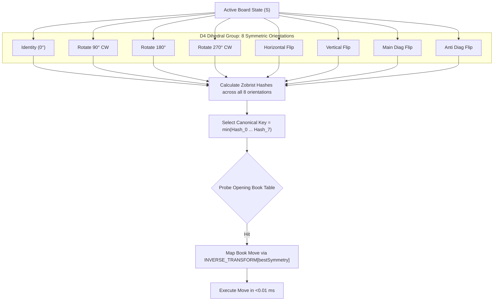

# 04 — Opening Book & Dihedral Symmetry

In tournament matches governed by strict time limits, spending valuable search time on the opening moves is counterproductive. The first 4 to 6 plies follow established theoretical principles: White vacates central escape corridors while Black deploys outward to establish perimeter blockades.

This document details the $D_4$ Dihedral Symmetry Group implementation, 8-fold memory compression, canonical line storage, and sub-millisecond lookup mechanics in `OpeningBook.java`.

---

## 1. The $D_4$ Dihedral Symmetry Group (8-Fold Compression)

The $9 \times 9$ Ashton Tablut board possesses complete square symmetry. A move played along the North axis is strategically identical to the equivalent move played along the South, East, or West axes.

The board's geometric symmetry is governed by the **Dihedral Group of order 8 ($D_4$)**, consisting of:
* **4 Rotations:** $0^\circ$ (identity), $90^\circ$ clockwise, $180^\circ$, and $270^\circ$ clockwise.
* **4 Reflections:** Horizontal reflection (across row 4), Vertical reflection (across col 4), Main diagonal reflection ($y = x$), and Anti-diagonal reflection ($y = -x$).

```
                Vertical Axis
                     │
         c8          │          g8
           \         │         /
            \        │        /
   b7        \       │       /        h7
              \      │      /
───────────────┼─────┼─────┼─────────────── Horizontal Axis
              /      │      \
   b3        /       │       \        h3
            /        │        \
           /         │         \
         c2          │          g2
                     │
          Main Diag     Anti Diag
```

### 1.1 Precomputed Coordinate Transformation Tables
To eliminate run-time coordinate transformations during search, `OpeningBook.java` precomputes two lookup matrices:

```java
public static final int[][] TRANSFORM = new int[8][81];
public static final int[][] INVERSE_TRANSFORM = new int[8][81];
```

For each square $\text{sq} = r \times 9 + c$:

| Index | Symmetry Operation | Coordinate Mapping $(r', c')$ |
| :---: | :--- | :--- |
| **0** | **Identity ($0^\circ$)** | $(r, c)$ |
| **1** | **Rotation $90^\circ$ CW** | $(c, 8 - r)$ |
| **2** | **Rotation $180^\circ$** | $(8 - r, 8 - c)$ |
| **3** | **Rotation $270^\circ$ CW** | $(8 - c, r)$ |
| **4** | **Horizontal Reflection** | $(8 - r, c)$ |
| **5** | **Vertical Reflection** | $(r, 8 - c)$ |
| **6** | **Main Diagonal Reflection** | $(c, r)$ |
| **7** | **Anti-Diagonal Reflection** | $(8 - c, 8 - r)$ |



### 1.2 Memory Compression & State Normalization
Rather than storing every opening move in all eight orientations, the opening book stores each position **only once** in its lexicographically smallest (canonical) orientation:

$$\text{CanonicalHash}(S) = \min_{k=0}^{7} \text{ZobristHash}(\text{Transform}_k(S))$$

This 8-fold reduction reduces memory footprint:
* 24 canonical opening lines spanning turns 1 through 5.
* 98 canonical states stored in memory.
* **784 reachable board positions** recognized instantaneously at run-time.

---

## 2. Canonical Ashton Opening Theory

The stored opening lines reflect Ashton Tablut principles:

### 2.1 White Opening Principles: Cross-Clearing
At the starting position, the King is surrounded by 8 defenders blocking all orthogonal rays. The primary White plan clears these internal defenders to open escape corridors:
1. `e4 -> e3`: Vacates the South corridor, allowing the King direct downward mobility.
2. `e6 -> e7`: Vacates the North corridor.
3. `d5 -> c5`: Vacates the West corridor.
4. `f5 -> g5`: Vacates the East corridor.

Clearing a defender along one axis forces Black to commit resources to block that corridor, opening opportunities for White on the perpendicular axis.

### 2.2 Black Opening Principles: Rhombus Deployment
Black starts with 16 pawns clustered in camps along the board edges. Moving haphazardly allows White to breakthrough. The canonical Black lines prioritize:
* **Preserving Camp Doorways:** The front soldiers (`e2, e8, b5, h5`) remain stationed at camp exits to prevent White from slipping behind the lines.
* **Occupying Rhombus Squares:** Flanking pawns exit their camps to occupy the Rhombus ring (`b5 -> b3`, `h5 -> h7`, `e2 -> c2`, `e8 -> g8`), erecting an outer barrier before White's King can escape the central zone.

### 2.3 Peer Counter-Lines
The opening book incorporates specific empirical counter-lines against common strategies used by peer engines:
* **Countering `f1 -> f3`:** If Black attempts an early flank attack with `f1 -> f3`, the book responds with `d5 -> d6`, threatening the North-West axis where Black's defensive structure is thinned.
* **Countering `e6 -> f6`:** If White plays an early flank move `e6 -> f6`, Black responds with `e8 -> g8`, anchoring the North-East quadrant and securing the Rhombus barrier.

### 2.4 Phase 13 Sanitization & The Throne Retention Invariant
During inter-version benchmark matches at 15s/move, an empirical vulnerability was uncovered: Line 1 of the opening book opened with `e3d3`, `e2c2`, `e4f4`, `e8g8`, followed on Move 3 by `e5 -> e4`.
* **The Vulnerability:** Vacating `e5` moved the King voluntarily out of the Castle onto `e4`. Under Ashton rules:
  1. On `e5`, the King requires 4 Black soldiers to be captured. Outside `e5`, it requires only 2.
  2. The vacated Throne immediately converted into a permanent hostile capture anvil (`throneAnvilThreats`), severing White's defense and allowing Black to pin the King against the southern camps.
* **The Fix:**
  - Deprecated `e5 -> e4` across all 24 canonical variations. White keeps the King anchored on the Throne while defenders clear peripheral corridors (`d5 -> d6`, `f5 -> f6`, `e4 -> c4`).
  - Added a strict runtime assertion in `OpeningBook.addLine`:
    ```java
    if (fromSq == BoardConstants.THRONE || toSq == BoardConstants.THRONE) {
        throw new IllegalArgumentException("Opening book cannot include moves from/to the Throne (e5)");
    }
    ```
  - This invariant guarantees that no dihedral transformation produces premature Throne evacuations.

---

## 3. Lookup Performance & Operational Modes

### 3.1 Sub-Millisecond Execution Profile
When `OpeningBook.findMove(state)` is called:
1. It applies the 8 transformations using precomputed lookup tables.
2. It probes the internal hash map for the canonical key.
3. Upon a match, it projects the canonical move back into real board coordinates using `INVERSE_TRANSFORM[symmetryIndex]`:

```java
int transformedFrom = Move.getFrom(canonicalMove);
int transformedTo = Move.getTo(canonicalMove);
int realFrom = INVERSE_TRANSFORM[bestSym][transformedFrom];
int realTo = INVERSE_TRANSFORM[bestSym][transformedTo];
return Move.encode(realFrom, realTo);
```

Total lookup latency is **$< 0.01 \text{ ms}$** (typically sub-microsecond on modern CPUs). The engine returns its move instantaneously on turns 1–5, preserving the entire clock budget for deep midgame searches.

### 3.2 Dual Operational Modes
`OpeningBook.java` supports two operational modes:
* **Deterministic Greedy Mode (`greedy = true`):**
  Used during official tournament matches. Always selects the move with the highest empirical win-rate weight for the canonical state.
* **Weighted Stochastic Sampling (`greedy = false`):**
  Used during automated SPSA parameter tuning. Candidate book moves are sampled probabilistically based on their relative weights, introducing game tree variety into training self-play matches.

---

## 4. Automated Opening Mining Pipeline (`scripts/mine_openings.py`)

To systematically discover and expand high-leverage opening variations against competitive opponents (such as BrAInmates, THoR, and Luca), the engine incorporates an automated opening log miner:

```bash
python scripts/mine_openings.py --logs-dir logs --max-plies 6 --min-winrate 0.70
```

1. **Log Ingestion:** Parses server match transcripts, reconstructing the sequence of moves and final game outcomes.
2. **Frequency & Win-Rate Aggregation:** Groups opening trajectories by canonical $D_4$ hash up to ply 6, computing empirical win/loss ratios for each branch.
3. **Java Code Generation:** Automatically synthesizes sanitized `addLine(...)` statements for high-winrate branches ($> 70\%$), ready for insertion into `OpeningBook.java` with automatic validation against the Throne retention invariant.

---

## 5. Phase 14 & 15 Opening Sanitization & Code Freeze

### 5.1 Tactical Outer-Cross Sanitization
Analysis of live tournament losses against deep engines revealed that early inner-cross moves (e.g., $1. \dots e4 \to d4$) left friendly defenders tactically hanging (*en prise*) to immediate double-flank captures on ply 2.

In Phase 15, White openings were sanitized to strictly favor secure outer-cross extensions:
* $1. e7 \to f7$
* $1. c5 \to c4$
* $1. g5 \to g6$
* Elimination of premature King moves and inner-corridor self-hanging moves.
* Dedicated Black counter-punishment line ($i4 \to e4$) punishing early White inaccuracies.

### 5.2 Stochastic $\varepsilon$-Greedy Selection (80 / 20)
To prevent adversarial competitors from precomputing refutation trees against deterministic lines, `OpeningBook.java` employs an $\varepsilon$-greedy policy:
* **80% Probability:** Plays the highest-rated principal canonical move.
* **20% Probability:** Selects among alternative high-quality theoretical responses.

### 5.3 Code Freeze Declaration
The opening book theory and coordinate transformation engine are **permanently frozen**. Future iterations rely solely on SPSA weight optimization for middlegame and endgame play.
