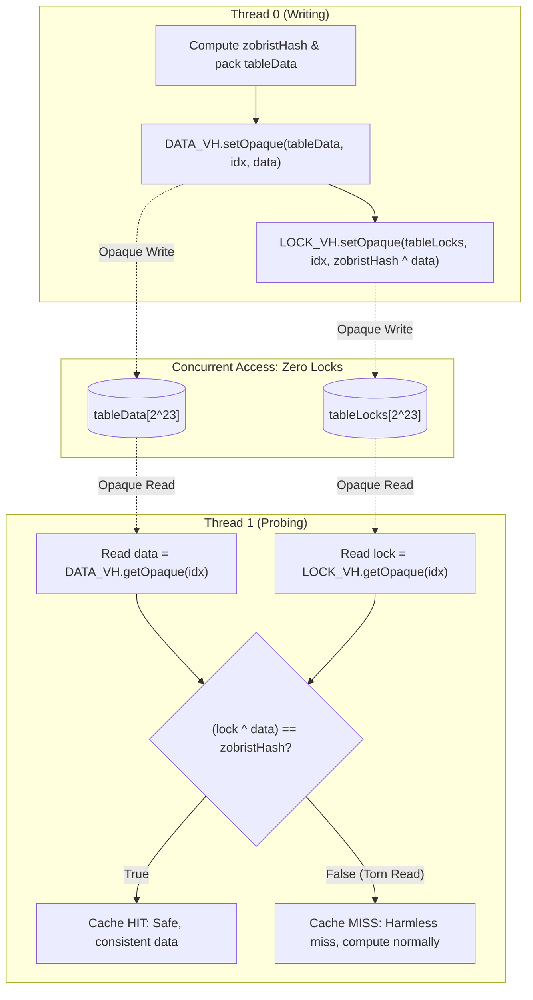

# 05 — Concurrency & Lazy SMP

Tournament matches run in a virtualized 4-vCPU Debian environment. Utilizing all four processor cores without incurring lock contention or synchronization latency is critical for reaching deep search plies within the allotted move timeout.

This document details the multi-core search coordinator (`ParallelSearchEngine.java`), the shared lockless Transposition Table (`TranspositionTable.java`), and the thread management invariants that maintain 0.0% CPU consumption during the opponent's turn.

---

## 1. Concurrency Model: Lazy SMP vs. Tree Partitioning

Parallelizing alpha-beta search on shared-memory multi-core systems is traditionally handled via two distinct architectures:

1. **Work-Stealing & Tree Splitting (e.g., Young Brothers Wait - YBW):**
   Threads split nodes deep in the search tree. When a thread encounters an all-node or cut-node, it spawns child tasks into a thread-safe work-stealing queue.
   * *The Problem:* YBW introduces severe synchronization overhead, lock contention, job-queue allocations, and thread starvation in asymmetric game trees with high branch-pruning rates.
2. **Lazy SMP (Shared Memory Parallelism):**
   All available worker threads execute independent Iterative Deepening Searches starting from the root position. The threads do not communicate directly, do not pass messages, and do not lock tree nodes. Instead, they interact exclusively by reading and writing to a single, globally shared **Transposition Table**.

```
+-------------------------------------------------------------------------+
|                    LAZY SMP SEARCH COORDINATOR                          |
|                                                                         |
|  [Master Thread 0]      [Helper Thread 1]     [Helper Thread 2] ...    |
|   IDS: Depth d           IDS: Depth d+1        IDS: Depth d             |
|   Root Order: 0,1,2..    Root Order: 1,2,0..   Root Order: 2,0,1..      |
|         │                      │                     │                  |
|         └──────────────┬───────┴─────────────┬───────┘                  |
|                        ▼                     ▼                          |
|       ┌─────────────────────────────────────────────────────────┐       |
|       │         GLOBAL LOCKLESS TRANSPOSITION TABLE             │       |
|       │           2^23 Entries (~134 MB, 2-Slot Buckets)        │       |
|       │          Bob Hyatt's XOR Verification Invariant         │       |
|       └─────────────────────────────────────────────────────────┘       |
+-------------------------------------------------------------------------+
```

### 1.1 Why Lazy SMP Wins
When Thread 0 searches a branch and writes its evaluated cutoffs, depths, and best moves into the shared Transposition Table, Threads 1, 2, and 3 immediately read those entries when reaching the same or transposed positions. The helper threads use those cached results to skip entire subtrees or reorder candidate moves, accelerating their own pruning.

There are no thread locks, no condition variables, and zero memory allocation. On 4 vCPUs, Lazy SMP delivers near-linear scaling without the debugging hazards of distributed tree splitting.

---

## 2. Lockless Transposition Table: Hyatt's XOR Invariant & 2-Slot Buckets

A shared Transposition Table accessed concurrently by 4 threads risks **data races**. If Thread $A$ writes an entry while Thread $B$ is reading it, Thread $B$ might read a "torn" 64-bit word (a hybrid entry with part of the old state and part of the new state), leading to corrupted moves or false cutoffs.

Synchronizing access via Java locks (`ReentrantLock`, `synchronized`, or `StampedLock`) degrades performance: thread contention on 20+ million operations per second destroys throughput.

`TranspositionTable.java` implements **Bob Hyatt's Lockless XOR Algorithm** combined with a **2-Slot Bucket architecture**, completely eliminating synchronization primitives:

### 2.1 Parallel Primitive Arrays & 2-Slot Layout
The table stores $2^{23} = 8,388,608$ entries organized into $4,194,304$ buckets using two parallel flat primitive arrays (~134 MB of heap memory):

```java
private final long[] tableLocks = new long[size]; // 8,388,608 slots
private final long[] tableData  = new long[size]; // 8,388,608 slots
```

Each bucket $b$ contains two contiguous slots:
* **Slot 0 (`idx = 2 * b`): Depth-Preferred Slot.**
  Stores high-depth strategic evaluations. A new entry replaces Slot 0 only if $d_{\text{new}} \ge d_{\text{old}}$ or if the existing entry belongs to an older search age.
* **Slot 1 (`idx = 2 * b + 1`): Always-Replace Fallback Slot.**
  Overwritten on every write collision, capturing short-lived tactical transpositions without dislodging deep nodes from Slot 0.

* `tableData[index]`: A packed 64-bit integer encoding move, score, depth, node type flag, and table age.
* `tableLocks[index]`: An XOR-masked verification word:

$$\text{tableLocks}[\text{index}] = \text{zobristHash} \oplus \text{tableData}[\text{index}]$$

```
64-Bit Packed tableData:
 63       40 39         24 23     16 15      8 7        0
+-----------+-------------+---------+---------+----------+
|   Score   |  Best Move  |  Depth  |  Flags  | Table Age|
| (24 bits) |  (16 bits)  | (8 bits)| (8 bits)| (8 bits) |
+-----------+-------------+---------+---------+----------+
```

### 2.2 Atomic Verification on Probe (`VarHandle` Opaque Access)
In Phase 16, `TranspositionTable.java` upgraded raw array accesses to Java **`MethodHandles.VarHandle` opaque reads/writes** (`LOCK_VH` and `DATA_VH`) with `LongAdder` diagnostics. Opaque mode prevents the JIT compiler from hoisting or tearing 64-bit `long` accesses across concurrent Lazy SMP workers while incurring zero mutex or memory-fence overhead.

When a thread probes a position with hash `zobristHash`:
1. It computes bucket index `b = (int)(zobristHash & bucketMask)`.
2. It tests Slot 0 (`idx = 2 * b`). If valid and matching, it uses Slot 0.
3. If Slot 0 misses, it immediately tests Slot 1 (`idx = 2 * b + 1`).

```java
long data = (long) DATA_VH.getOpaque(tableData, slotIdx);
long lock = (long) LOCK_VH.getOpaque(tableLocks, slotIdx);

if ((lock ^ data) == zobristHash) {
    // Valid entry: data is consistent and matches current position
    int move  = (int)((data >>> 24) & 0xFFFF);
    int score = (int)(data >> 40);
    int depth = (int)((data >>> 16) & 0xFF);
    int flag  = (int)((data >>> 8) & 0xFF);
    // Proceed with cutoff or move ordering...
}
```

If a concurrent thread overwrites `tableData[index]` during a read, the relationship `(lock ^ data) == zobristHash` breaks with near certainty (collision probability $2^{-64}$). The read simply registers as a harmless cache miss. The thread falls back to computing the search branch normally, avoiding corrupted evaluations without requiring mutex locks.



---

## 3. Search Coordination & Worker Diversification

If four threads execute identical searches, they explore the same nodes and provide no speedup. `ParallelSearchEngine.java` introduces deliberate search diversification:

### 3.1 Depth Staggering
Helper threads start search iterations at alternating depth offsets:
* Master Thread 0: $d = 1, 2, 3, 4, 5, \dots$
* Helper Thread 1: Starts at depth $1 + (1 \pmod 2) = 2$
* Helper Thread 2: Starts at depth $1 + (2 \pmod 2) = 1$
* Helper Thread 3: Starts at depth $1 + (3 \pmod 2) = 2$

Helper threads search ahead or around the master thread, pre-populating deeper positions in the shared Transposition Table.

### 3.2 Root Move Permutations
At the root of the search tree, each worker thread evaluates the candidate moves in a shifted order:

$$\text{Index}_{\text{thread } t}(i) = (i + t) \pmod N_{\text{moves}}$$

Worker threads evaluate different initial candidate moves as their primary branches. The first thread to establish a $\beta$-cutoff populates the Transposition Table, allowing other threads to immediately prune identical subtrees when they reach those moves.

### 3.3 Forced-Loss-Protected Worker Selection (`isBetterWorkerResult`) & Partial-Depth Adoption
Upon joining all worker threads at the search deadline, `ParallelSearchEngine.chooseBestWorker` reconciles results via `isBetterWorkerResult` (hardened in Phases 15–17):
* **Faster Forced Mate Wins:** Any worker finding a strictly shorter forced win (`score >= WIN_THRESHOLD`) takes immediate priority.
* **Forced-Loss Depth Protection:** A shallower search result (e.g., Depth 8) can never overwrite a deeper worker's forced-loss detection (e.g., Depth 9 `-WIN + ply`), preventing blind optimism from hiding a proven tactical loss.
* **Equal-Depth Non-Loss Survival & Delayed-Loss Preference:** At equal depth, a non-loss heuristic score always replaces a forced-loss score; if both are forced losses, the line delaying defeat longer is preferred.
* **Verified Partial-Depth Root Adoption:** Each worker adopts an in-window non-hanging improvement (`alpha < bestScoreThisDepth < beta`) completed at depth $d$ after `rootMoves[0]` finished when the hard deadline interrupts mid-iteration.

---

## 4. The Opponent-Turn Invariant (0.0% CPU Usage)

Tournament rules explicitly prohibit computing during the opponent's turn. Any background pondering or asynchronous search while the referee server awaits the opponent's move results in disqualification.

`ParallelSearchEngine.java` and `TablutAgentClient.java` enforce this constraint:

1. **Worker Thread Join:** When the search deadline expires or the master thread completes depth traversal, the coordinator sets a `volatile boolean stopped = true` flag.
2. All helper threads terminate their active search loops, unwind their stacks, and are joined back into a dormant thread pool.
3. The client writes its move to the referee TCP socket and immediately executes a **synchronous, blocking read** (`socket.getInputStream().read()`).
4. While waiting for the opponent's move, all four cores drop to **0.0% CPU usage**, satisfying tournament execution requirements.
