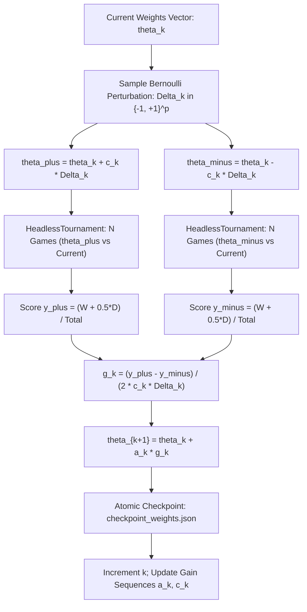

# 06 — Offline Tuning Pipeline (SPSA)

Manual heuristic tuning in board game engines is notoriously inefficient. Adjusting one parameter in isolation (such as increasing the King escape bonus) disrupts interactions with other terms (such as defender mobility or capture incentives), often reducing overall playing strength.

This document details the automated offline parameter tuning architecture: the in-memory headless simulator (`HeadlessTournament.java`), the Simultaneous Perturbation Stochastic Approximation (SPSA) optimizer (`train_spsa.py`), and the atomic checkpointing pipeline.

---

## 1. High-Throughput Headless Simulator (`HeadlessTournament.java`)

Tuning heuristic parameters requires playing hundreds of thousands of games to achieve statistical significance. Running matches through the official Java GUI or TCP server is too slow, bottlenecked by network socket serialization and thread synchronization.

`HeadlessTournament.java` executes self-play matches entirely in RAM:
* **Zero Networking / Zero GUI:** FastState instances play directly against FastState instances via pure method calls.
* **ThreadLocal Zero-Allocation Context Recycling (`EngineContext`):**
  Early simulator iterations allocated new search stacks, move generator buffers, and Transposition Tables for every match, generating over 67 MB of heap garbage per game. Under 8 parallel simulator threads, GC pauses throttled CPU execution.
  The simulator introduces an `EngineContext` pool tied to Java `ThreadLocal` storage. Thread workers allocate their state and search buffers exactly once at startup, recycling them across millions of subsequent turns with zero heap churn.
* **Strict Color Balancing & Common Random Numbers (CRN, Phase 16):**
  Matches are paired in alternating pairs: Game $2k$ pits Parameter Vector $A$ (White) against Vector $B$ (Black); Game $2k+1$ immediately mirrors the matchup with Vector $B$ (White) against Vector $A$ (Black) using the **exact same deterministic opening seed** (`--seed`). This CRN variance-reduction scheme eliminates opening-draw luck between paired evaluations (identical vectors score exactly `50.00%` by construction) and reports granular `winsAWhite` / `winsABlack` telemetry for color-regression gating.
* **Opening Tree Diversification:**
  Each paired game opens with `--opening-book-plies 4` followed by `--opening-random-plies 2` legal moves seeded deterministically per pair, ensuring the simulator explores realistic yet diverse middlegames rather than repeating identical lines.

---

## 2. Simultaneous Perturbation Stochastic Approximation (SPSA)

The heuristic engine is governed by $p = 24$ continuous parameters (`NUM_WEIGHTS = 24`). Traditional gradient estimation via Finite Differences requires perturbing each parameter individually:

$$\text{Finite Differences Cost} = 2 \times p = 48 \text{ evaluations per gradient step}$$

Playing $N = 100$ games per evaluation would require 4,400 games just to take a single gradient step. In noisy environments where game outcomes are binary (win, loss, draw), finite difference optimization is computationally intractable.

### 2.1 The SPSA Gradient Estimator
SPSA estimates the entire $p$-dimensional gradient vector using only **two evaluations**, regardless of how many parameters are being tuned:



1. **Simultaneous Perturbation Vector:**
   Sample a random vector $\Delta_k \in \{-1, +1\}^p$ from a symmetric Bernoulli distribution:

   $$\Delta_k = [\pm 1, \pm 1, \dots, \pm 1]^T$$

2. **Perturbed Evaluations:**
   Evaluate two symmetric test configurations:

   $$\theta_k^+ = \theta_k + c_k \Delta_k, \qquad \theta_k^- = \theta_k - c_k \Delta_k$$

3. **Gradient Approximation:**
   The gradient vector $g_k(\theta_k)$ is approximated across all $p$ components simultaneously:

   $$g_{k,i}(\theta_k) = \frac{y(\theta_k^+) - y(\theta_k^-)}{2 c_k \Delta_{k,i}}$$

4. **Parameter Update:**
   Update the parameter vector along the approximated ascent gradient:

   $$\theta_{k+1} = \theta_k + a_k g_k(\theta_k)$$

### 2.2 Gain Sequences & Decay Schedules
The step size $a_k$ (learning rate) and perturbation magnitude $c_k$ follow standard asymptotic decay schedules to guarantee convergence:

$$a_k = \frac{a}{(A + k + 1)^\alpha}, \qquad c_k = \frac{c}{(k + 1)^\gamma}$$

* $a$: Initial learning rate scalar.
* $A$: Stability threshold (typically 10% of total planned iterations) preventing excessively large updates in early iterations.
* $c$: Baseline perturbation radius.
* Standard stability exponents: $\alpha = 0.602$, $\gamma = 0.101$.

### 2.3 Objective Function & Draw Penalization
Match results are mapped to an objective score:

$$\text{Score} = \frac{W + 0.5 \cdot D}{W + L + D}$$

In Tablut, repetitive play can cause engines to drift into sterile, cycling draws. The optimizer incorporates a draw-suppression penalty when win rates stagnate, rewarding parameter configurations that force decisive outcomes over passive repetitions.

---

## 3. Multi-Stage Depth-5/6 Overnight Pipeline (`scripts/overnight_60s_pipeline.py`)

Tuning all 24 parameters simultaneously at shallow depths (Depth 3/4) introduces short-horizon bias that fails to generalize to 60s tournament play (Depth 13–18). In Phase 17, we introduced the end-to-end multi-stage Depth-5/6 pipeline (`scripts/overnight_60s_pipeline.py`), complemented by the 2-phase runner (`scripts/train_overnight.py`, upgraded to Depth 5 `white_focus` $\to$ Depth 6 `all`).

### 3.1 Four-Stage Depth-5/6 Curriculum (Nov 18–19 Run: 38,668 Games)
1. **Stage 1 (`stage1_d5_white.json` — Depth 5, `white_focus`):** Calibrates the 11 White initiative/escape/cohesion weights (`indices [0, 2, 3, 4, 5, 6, 7, 17, 18, 21, 22]`) with all Black weights strictly frozen (**245 iterations, 17,836 games**, 90.7 min).
2. **Stage 2A (`stage2a_d6_white.json` — Depth 6, `white_focus`):** Refines White weights under deeper tactical lookahead seeded from Stage 1's best checkpoint (**72 iterations, 3,192 games**, 92.5 min).
3. **Stage 2B (`stage2b_d5_all.json` — Depth 5, `all` + `black_ok` gate):** Co-tunes all active weights simultaneously while enforcing a strict **Black non-regression promotion gate** (`wr >= 0.52` AND `winsABlack + 1 >= incumbentBlackWins`) (**184 iterations, 16,142 games**, 80.7 min).
4. **Stage 2C (`stage2c_d6_all.json` — Depth 6, `all`):** Deep polish over the joint parameter space (**33 iterations, 1,498 games**, 52.5 min).

### 3.2 Multi-Resolution Championship Shootout & Certified Auto-Apply
At completion of SPSA optimization:
1. **Stage 3 (Multi-Resolution Shootout):** All stage peak and EMA checkpoints are evaluated against `v0_pre_night_anchor.json` across Depth 5 (`r1`), unlocked-depth `750ms` (`r2`), and unlocked-depth `1200ms` (`r3`) matches with strict Black safety filtering. In the Nov 18–19 run, **`S2B_d5_all_best`** won (`logs/checkpoints_overnight/selected_winner.json`).
2. **Stage 4 (Certified Apply & Rollback Guard):** `apply_weights.py` injects the winning vector into `HeuristicWeights.java`, recompiles with `javac -encoding UTF-8`, and executes all **12 Java unit test suites** (automatically rolling back to `v0_pre_night_anchor.json` if any test fails).
3. **Stage 5 (Official 60s `Server.jar` Validation):** Optional end-to-end 60s/move validation on the official referee server (`--skip-server` to run tuning and unit tests only).

```bash
# Run the full Depth-5/6 overnight optimization + 60s validation pipeline
python scripts/overnight_60s_pipeline.py
```

### 3.3 Warm Restarts, Time Guards & Session-Relative Gain Scheduling
When resuming training from a saved checkpoint, naive SPSA implementations apply the decayed iteration counter $k$, resulting in near-zero learning rates ($a_k \approx 0$).

`train_spsa.py` implements `--warm-restart`, custom `--checkpoint` paths, and `--max-minutes` graceful time limits. It preserves the accumulated weight vector while resetting the step-size schedule to an active exploratory range, enabling clean multi-stage chaining with Windows keep-awake protection (`SetThreadExecutionState`).

---

## 4. Atomic Checkpointing & Parameter Injection

Long-running optimization processes on remote compute clusters risk data corruption from unexpected system terminations, out-of-memory errors, or SSH disconnects.

### 4.1 Safe Atomic Checkpointing
The Python training scripts never write directly to `checkpoint_weights.json`. Instead, state serialization follows an atomic write-and-rename pattern:

```python
temp_file = "checkpoint_weights.json.tmp"
with open(temp_file, "w") as f:
    json.dump(checkpoint_data, f, indent=2)
os.replace(temp_file, "checkpoint_weights.json")
```

On POSIX and modern Windows systems, `os.replace()` is an atomic filesystem operation. If the training process is terminated mid-write, the existing checkpoint remains completely uncorrupted.

### 4.2 Parameter Injection: `apply_weights.py`
Once an optimization phase converges, `apply_weights.py` reads the best parameter vector from `checkpoint_weights.json`, formats the integers, and directly patches the default constants in `HeuristicWeights.java`:

```bash
python scripts/apply_weights.py --input checkpoint_weights.json --compile
```

The script verifies syntax, substitutes the weight constants, triggers a clean build via `javac`, and executes the regression test suite (`RuleVerificationTest`, `SearchEngineTest`) to confirm that zero-allocation invariants remain satisfied.

---

## 5. Feature Orthogonality & SVD/PCA Audit (`scripts/analyze_feature_covariance.py`)

In 24-dimensional heuristic spaces, collinearity between features (e.g., `rhombusBlockade` vs. `blackConnectedChains`) can cause SPSA perturbations to cancel each other out, stalling optimization.

`scripts/analyze_feature_covariance.py` provides an offline audit tool:
```bash
python scripts/analyze_feature_covariance.py --states 20000 --generate
```
1. **Matrix Extraction:** `FeatureMatrixGenerator.java` extracts raw feature vectors $\mathbf{f}(s) \in \mathbb{R}^{24}$ from 20,000 board positions generated by headless self-play.
2. **Pearson Correlation Matrix $\mathbf{R}$:** Flags any feature pair with correlation $|r| > 0.85$ for decoupling or regularization.
3. **Singular Value Decomposition (SVD):** Evaluates the condition number $\kappa(\mathbf{X})$ and spectral decay to verify that all 24 features contribute independent geometric information to the evaluation function.

---

## 6. Post-Phase 17 Freeze Status

Following the Phase 17 Depth-5/6 CRN SPSA run (**38,668 games**, selected vector `S2B_d5_all_best`) and full 12-suite Java verification, both the Java engine and the 24 calibrated weights in `HeuristicWeights.java` / `checkpoint_weights.json` are **frozen for tournament submission**.
