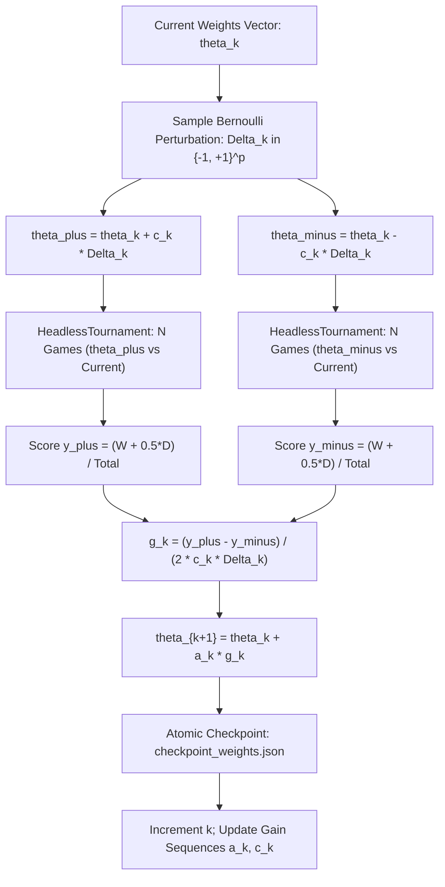

# 06 — Offline Tuning Pipeline (SPSA)

Manual heuristic tuning in board game engines is notoriously inefficient. Adjusting one parameter in isolation (such as increasing the King escape bonus) disrupts interactions with other terms (such as defender mobility or capture incentives), often reducing overall playing strength.

This document details the automated offline parameter tuning architecture: the in-memory headless simulator (`HeadlessTournament.java`), the Simultaneous Perturbation Stochastic Approximation (SPSA) optimizer (`train_spsa.py`), and the atomic checkpointing pipeline.

---

## 1. High-Throughput Headless Simulator (`HeadlessTournament.java`)

Tuning heuristic parameters requires playing hundreds of thousands of games to achieve statistical significance. Running matches through the official Java GUI or TCP server is too slow, bottlenecked by network socket serialization and thread synchronization.

`HeadlessTournament.java` executes self-play matches entirely in RAM:
* **Zero Networking / Zero GUI:** FastState instances play directly against FastState instances via pure method calls.
* **ThreadLocal Zero-Allocation Context Recycling (`EngineContext`):**
  Early simulator iterations allocated new search stacks, move generator buffers, and Transposition Tables for every match, generating over 67 MB of heap garbage per game. Under 8 parallel simulator threads, GC pauses throttled CPU execution.
  The simulator introduces an `EngineContext` pool tied to Java `ThreadLocal` storage. Thread workers allocate their state and search buffers exactly once at startup, recycling them across millions of subsequent turns with zero heap churn.
* **Strict Color Balancing:**
  Matches are paired in alternating pairs: Game $2k$ pits Parameter Vector $A$ (White) against Vector $B$ (Black); Game $2k+1$ immediately mirrors the matchup with Vector $B$ (White) against Vector $A$ (Black). This eliminates first-player advantage bias from parameter evaluation.
* **Opening Tree Diversification:**
  During the first two plies ($K=2$), moves are sampled uniformly at random from legal candidates, ensuring the simulator explores diverse board states rather than repeating identical deterministic lines.

---

## 2. Simultaneous Perturbation Stochastic Approximation (SPSA)

The heuristic engine is governed by $p = 22$ continuous parameters (`NUM_WEIGHTS = 22`). Traditional gradient estimation via Finite Differences requires perturbing each parameter individually:

$$\text{Finite Differences Cost} = 2 \times p = 44 \text{ evaluations per gradient step}$$

Playing $N = 100$ games per evaluation would require 4,400 games just to take a single gradient step. In noisy environments where game outcomes are binary (win, loss, draw), finite difference optimization is computationally intractable.

### 2.1 The SPSA Gradient Estimator
SPSA estimates the entire $p$-dimensional gradient vector using only **two evaluations**, regardless of how many parameters are being tuned:



1. **Simultaneous Perturbation Vector:**
   Sample a random vector $\Delta_k \in \{-1, +1\}^p$ from a symmetric Bernoulli distribution:

   $$\Delta_k = [\pm 1, \pm 1, \dots, \pm 1]^T$$

2. **Perturbed Evaluations:**
   Evaluate two symmetric test configurations:

   $$\theta_k^+ = \theta_k + c_k \Delta_k, \qquad \theta_k^- = \theta_k - c_k \Delta_k$$

3. **Gradient Approximation:**
   The gradient vector $g_k(\theta_k)$ is approximated across all $p$ components simultaneously:

   $$g_{k,i}(\theta_k) = \frac{y(\theta_k^+) - y(\theta_k^-)}{2 c_k \Delta_{k,i}}$$

4. **Parameter Update:**
   Update the parameter vector along the approximated ascent gradient:

   $$\theta_{k+1} = \theta_k + a_k g_k(\theta_k)$$

### 2.2 Gain Sequences & Decay Schedules
The step size $a_k$ (learning rate) and perturbation magnitude $c_k$ follow standard asymptotic decay schedules to guarantee convergence:

$$a_k = \frac{a}{(A + k + 1)^\alpha}, \qquad c_k = \frac{c}{(k + 1)^\gamma}$$

* $a$: Initial learning rate scalar.
* $A$: Stability threshold (typically 10% of total planned iterations) preventing excessively large updates in early iterations.
* $c$: Baseline perturbation radius.
* Standard stability exponents: $\alpha = 0.602$, $\gamma = 0.101$.

### 2.3 Objective Function & Draw Penalization
Match results are mapped to an objective score:

$$\text{Score} = \frac{W + 0.5 \cdot D}{W + L + D}$$

In Tablut, repetitive play can cause engines to drift into sterile, cycling draws. The optimizer incorporates a draw-suppression penalty when win rates stagnate, rewarding parameter configurations that force decisive outcomes over passive repetitions.

---

## 3. Curriculum Training & Overnight Pipeline (`scripts/train_overnight.py`)

Tuning all 22 parameters simultaneously at deep search depths without preconditioning can induce gradient noise. The automated multi-night optimization pipeline (`train_overnight.py`) implements a staged two-phase curriculum with anytime interrupt safety:

### 3.1 Two-Phase Training Strategy
* **Phase 1: Positional & Acclimatization Warm-up (`--warmup-iters 300`):**
  - **Search Depth:** Depth 3 + Quiescence search.
  - **Match Sample:** $N = 60$ games per step with strict color balancing.
  - **Target Subspace:** 7 key spatial parameters (`kingOpenFieldContainment`, `blackConnectedChains`, `rhombusBlockade`, `campFrontPreserved`, `diamondOccupancy`, `kingDefenderShieldCohesion`, `whitePawnDispersionPenalty`).
  - **Objective:** Calibrates the relative magnitude of spatial weights without destabilizing macroscopic piece values.
* **Phase 2: Global Covariance Fine-Tuning (`--depth 4`):**
  - **Search Depth:** Depth 4 + Quiescence search.
  - **Match Sample:** $N = 80$ games per step (reducing gradient variance across 22 dimensions).
  - **Target Subspace:** All 22 parameters tuned simultaneously (`all`).
  - **Objective:** Eliminates short-horizon Depth 3 bias, tuning compound terms (`kingSafeForkThreat`, `campPinchTraps`, `throneAnvilThreats`). Runs continuously in anytime mode.

### 3.2 Automated Checkpoint & Safe Termination
The script supports `--auto-apply`, which handles graceful `Ctrl+C` interrupts:
```bash
python scripts/train_overnight.py --skip-warmup --depth 4 --auto-apply
```
When interrupted, it atomically writes the current best weights to `checkpoint_weights.json`, invokes `apply_weights.py` to patch `HeuristicWeights.java`, recompiles the Java engine, and verifies test suites.

### 3.3 Warm Restarts & Session-Relative Gain Scheduling
When resuming training from a saved checkpoint, naive SPSA implementations apply the decayed iteration counter $k$, resulting in near-zero learning rates ($a_k \approx 0$).

`train_spsa.py` implements a `--warm-restart` flag. It preserves the accumulated weight vector from `checkpoint_weights.json` but resets the step-size schedule to an active exploratory range ($a_k \approx 1.50$), allowing the optimizer to escape local plateaus during overnight runs.

---

## 4. Atomic Checkpointing & Parameter Injection

Long-running optimization processes on remote compute clusters risk data corruption from unexpected system terminations, out-of-memory errors, or SSH disconnects.

### 4.1 Safe Atomic Checkpointing
The Python training scripts never write directly to `checkpoint_weights.json`. Instead, state serialization follows an atomic write-and-rename pattern:

```python
temp_file = "checkpoint_weights.json.tmp"
with open(temp_file, "w") as f:
    json.dump(checkpoint_data, f, indent=2)
os.replace(temp_file, "checkpoint_weights.json")
```

On POSIX and modern Windows systems, `os.replace()` is an atomic filesystem operation. If the training process is terminated mid-write, the existing checkpoint remains completely uncorrupted.

### 4.2 Parameter Injection: `apply_weights.py`
Once an optimization phase converges, `apply_weights.py` reads the best parameter vector from `checkpoint_weights.json`, formats the integers, and directly patches the default constants in `HeuristicWeights.java`:

```bash
python scripts/apply_weights.py --input checkpoint_weights.json --compile
```

The script verifies syntax, substitutes the weight constants, triggers a clean build via `javac`, and executes the regression test suite (`RuleVerificationTest`, `SearchEngineTest`) to confirm that zero-allocation invariants remain satisfied.

---

## 5. Feature Orthogonality & SVD/PCA Audit (`scripts/analyze_feature_covariance.py`)

In 22-dimensional heuristic spaces, collinearity between features (e.g., `rhombusBlockade` vs. `blackConnectedChains`) can cause SPSA perturbations to cancel each other out, stalling optimization.

`scripts/analyze_feature_covariance.py` provides an offline audit tool:
```bash
python scripts/analyze_feature_covariance.py --states 20000 --generate
```
1. **Matrix Extraction:** `FeatureMatrixGenerator.java` extracts raw feature vectors $\mathbf{f}(s) \in \mathbb{R}^{22}$ from 20,000 board positions generated by headless self-play.
2. **Pearson Correlation Matrix $\mathbf{R}$:** Flags any feature pair with correlation $|r| > 0.85$ for decoupling or regularization.
3. **Singular Value Decomposition (SVD):** Evaluates the condition number $\kappa(\mathbf{X})$ and spectral decay to verify that all 22 features contribute independent geometric information to the evaluation function.
