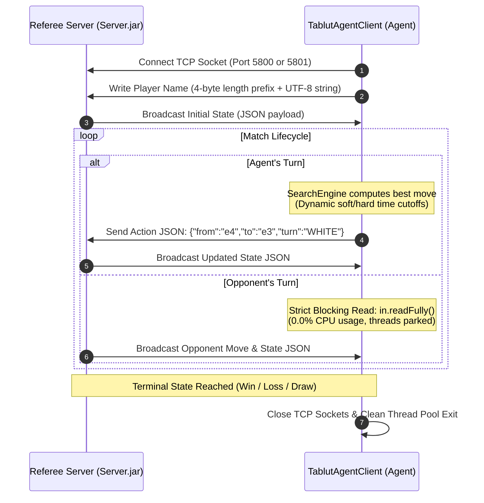

# 07 — Protocol, CLI & Execution

Deploying an autonomous game agent into the official tournament evaluation framework requires strict adherence to network framing protocols, command-line arguments, virtual machine hardware limitations, and computational activity rules.

This document details the TCP wire protocol, dynamic time allocation safeguards, competition VM constraints, and execution scripts implemented in `TablutAgentClient.java`, `StateAdapter.java`, and `runmyplayer.sh`.

---

## 1. TCP Wire Protocol & Message Framing

The competition referee server communicates with players over standard TCP sockets:
* **White Player Connection:** Port `5800`
* **Black Player Connection:** Port `5801`

### 1.1 4-Byte Big-Endian Length-Prefixed Framing
All socket communication uses big-endian 4-byte integer length framing:

```
+-----------------------------+------------------------------------+
| Payload Length (4 Bytes)     | UTF-8 Encoded Payload String       |
| Big-Endian Integer (Network)| (JSON Object or Player Name)       |
+-----------------------------+------------------------------------+
```

In Java, this framing is handled via `DataOutputStream` and `DataInputStream`:

```java
// Writing a framed message
byte[] bytes = jsonString.getBytes(StandardCharsets.UTF_8);
outputStream.writeInt(bytes.length);
outputStream.write(bytes);
outputStream.flush();

// Reading a framed message
int length = inputStream.readInt();
byte[] buffer = new byte[length];
inputStream.readFully(buffer);
String response = new String(buffer, StandardCharsets.UTF_8);
```

### 1.2 Handshake & Message Exchanges
1. **Handshake:** Immediately upon opening the TCP connection, the client sends its player name string (e.g., `"Antigravity"`).
2. **Initial State:** The client blocks on the socket to read the referee server's initial board state JSON.
3. **Turn Loop:**
   * When it is the agent's turn to move, it computes the best action and dispatches a JSON move:
     ```json
     {"from": "e4", "to": "e3", "turn": "WHITE"}
     ```
   * When it is the opponent's turn, the client enters a blocking read awaiting the server's state update broadcast.



---

## 2. Dynamic Time Management & Two-Tier Cutoffs

The referee server dynamically configures move timeout limits via command-line arguments (typically 60s, 30s, or 15s). Exceeding the timeout by even a single millisecond causes an immediate forfeit.

`SearchEngine.java` dynamically calculates search budgets based on the `<TIMEOUT_SECONDS>` parameter passed at startup:

### 2.1 The Two-Tier Cutoff Architecture
1. **Tier 1: Predictive Soft Cutoff with Dynamic $b_{\text{eff}}$ Calibration (Root Level):**
   Iterative deepening checks before initiating depth iteration $d+1$. It calculates the estimated time required for the next depth using a dynamically calibrated effective branching factor:

   $$b_{\text{eff}} = \text{clamp}\left(2.2, \, 4.5, \, \frac{T_d}{T_{d-1}}\right)$$

   $$T_{\text{projected}} = T_{\text{elapsed}} + (T_d \times b_{\text{eff}})$$

   If $T_{\text{projected}} > T_{\text{budget}}$, depth $d+1$ is aborted before it starts. The engine returns the best move verified at depth $d$.
2. **Tier 2: Emergency Hard Cutoff (Interior Tree Nodes):**
   If an iteration takes longer than expected, interior nodes poll the clock every 4096 nodes using bitwise masking:

   ```java
   if ((nodesVisited & 4095) == 0) {
       if (System.currentTimeMillis() >= hardDeadline) {
           this.stopped = true;
           return 0; // Immediate unwind
       }
   }
   ```

   Bitwise polling `(nodesVisited & 4095) == 0` avoids calling `System.currentTimeMillis()` at every node, eliminating system-call overhead while ensuring a hard stop within 1-2 milliseconds of the deadline.

### 2.2 Configurable Safety Ratio
To account for JVM thread scheduling jitter, GC stalls, and network transmission latency, the engine sets:

$$\text{timeSafetyRatio} = 0.90$$

The search operates within $90\%$ of the allowed time limit, reserving a strict $10\%$ safety buffer.

---

## 3. Strict Adversary Turn Invariant (0.0% CPU)

> [!IMPORTANT]
> Official competition rules strictly prohibit running search threads, background pondering, or speculative evaluation while waiting for the opponent's move.

`TablutAgentClient.java` guarantees compliance:
* As soon as a move is transmitted to the referee server, all worker threads in `ParallelSearchEngine` are stopped and joined.
* The main thread invokes `DataInputStream.readFully()`, entering a kernel-level blocking read on the TCP socket.
* CPU utilization remains at **0.0%** throughout the opponent's entire turn, preventing disqualification.

---

## 4. Competition VM Constraints & Deployment

Tournament evaluation takes place inside a headless Debian Linux VirtualBox appliance:
* **Hardware:** 4 vCPUs, 8 GB RAM, 30 GB disk.
* **No GPU:** All search, heuristic evaluation, and matrix transformations run exclusively on CPU.
* **Zero Internet Connectivity:** The VM is completely disconnected from external networks during matches. All bytecode, opening books, and runtime assets are pre-packaged locally.
* **Disk Space Conservation:** The VM evaluation environment monitors disk consumption. Verbose debug logging to stdout or sprawling disk log files can saturate storage, triggering disqualification. Standard stdout is silenced in production.

### 4.1 CLI Execution Syntax
The official execution script conforms to the competition specification:

```bash
/home/tablut/tablut/runmyplayer.sh <ROLE> <TIMEOUT_SECONDS> <SERVER_IP>
```

Parameters must be handled in exact positional order:
1. `<ROLE>`: `WHITE` or `BLACK` (**strictly case-insensitive**, e.g., `white`, `White`, `WHITE`).
2. `<TIMEOUT_SECONDS>`: Integer specifying the maximum allowed decision time per move.
3. `<SERVER_IP>`: IP address of the referee server.

### 4.2 Script Architecture (`runmyplayer.sh`)
The execution wrapper is formatted with POSIX `LF` line endings (not Windows `CRLF`) and executable permissions (`chmod +x`):

```bash
#!/bin/bash
# Official Tablut Competition Execution Wrapper
ROLE="$1"
TIMEOUT="$2"
SERVER_IP="$3"

if [ -z "$ROLE" ] || [ -z "$TIMEOUT" ] || [ -z "$SERVER_IP" ]; then
    echo "Usage: ./runmyplayer.sh <ROLE> <TIMEOUT_SECONDS> <SERVER_IP>"
    exit 1
fi

SCRIPT_DIR="$(cd "$(dirname "${BASH_SOURCE[0]}")" && pwd)"
BIN_DIR="$SCRIPT_DIR/bin"
LIB_SERVER="$SCRIPT_DIR/TablutCompetition-master/Tablut/Executables/Server.jar"

exec java -cp "$BIN_DIR:$LIB_SERVER" tablut.engine.TablutAgentClient "$ROLE" "$TIMEOUT" "$SERVER_IP"
```

---

## 5. Tournament Harnesses & Peer Benchmarking

The engine includes automated match orchestration scripts to validate performance against baseline clients and champion historical engines:

### 5.1 Multi-Competitor Gauntlet (`scripts/tournament_vs_opponents.ps1`)
Orchestrates round-robin tournaments against configured competitors (`competitors/`):
```powershell
# Run tournament against all available competitors at 45s/move:
.\scripts\tournament_vs_opponents.ps1 -Opponent all -Games 2 -Timeout 45

# Targeted match against BrAInmates (1st Place UNIBO 2020 Champion):
.\scripts\tournament_vs_opponents.ps1 -Opponent brainmates -Games 4 -Timeout 45

# Targeted match against THoR (3rd Place UNIBO 2020):
.\scripts\tournament_vs_opponents.ps1 -Opponent thor -Games 4 -Timeout 45
```

### 5.2 Peer-Engine Benchmarking (`scripts/tournament_vs_luca.ps1`)
Runs paired matches against teammate Luca Peratella's neural MCTS / Negamax architecture (`team/luca`):
```powershell
.\scripts\tournament_vs_luca.ps1 -Games 2 -Timeout 45
```

### 5.3 Inter-Version Regression Harness (`scripts/match_versions.ps1`)
Pits the current working tree against any previous Git commit to detect regressions or verify opening book adjustments:
```powershell
.\scripts\match_versions.ps1 -Games 2 -Timeout 15 -Commit HEAD~1
```
