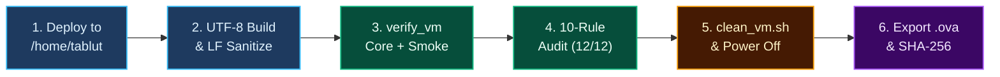

# 08 — VM Deployment & Verification Guide (Pre-Submission Readiness)

This guide provides the complete, step-by-step procedure for importing, configuring, building, running, and rigorously verifying the DajeGeppetto Tablut agent inside the official Debian competition Virtual Machine (VM) prior to tournament submission.

Following this runbook guarantees that the agent satisfies all official tournament regulations set by the University of Bologna course staff, preventing automatic disqualification due to runtime failures, network dependencies, illegal moves, timeout forfeits, or disk saturation.



---

## 1. Official Competition Environment & Regulations

The evaluation framework executes all matches within an isolated VirtualBox virtual appliance:

| Specification | Official Constraint | Agent Implementation / Safety Margin |
| :--- | :--- | :--- |
| **Operating System** | Debian Linux 64-bit | Pure Java 8+ bytecode, POSIX LF execution wrapper |
| **Compute / vCPUs** | **4 vCPUs** | 4-thread Lazy SMP search coordinator (`ParallelSearchEngine`) |
| **System Memory** | **8 GB RAM** | Zero-allocation search; Transposition Table sized to 134 MB |
| **Disk Storage** | **30 GB max** | Silent stdout/stderr output; zero logging to disk in production |
| **GPU Acceleration** | **NONE (Pure CPU)** | 100% CPU-based search and bitwise heuristic evaluation |
| **Network Access** | **ISOLATED (No Internet)** | 100% self-contained; zero online asset fetching or pip/apt calls |
| **Move Timeout** | Configured by server (15s–60s) | Two-tier dynamic time manager (`timeSafetyRatio = 0.96`, 82% soft cutoff, partial-depth adoption) |
| **Opponent Turn** | **0.0% CPU computation** | Thread pool parked; strict kernel-level blocking TCP socket read |
| **Submission Deadline**| **November 22, 23:59 (Italian Time)** | Delivered via Virtuale assignment with OneDrive VM link |

---

## 2. Step-by-Step VM Installation & Setup

### Step 2.1: Download & Import the Official Virtual Machine
1. Download the official VM image provided by the course professors:
   * **OneDrive Link:** Provided in `docs/references/PresentazioneTablutChallenge2627.pdf`
   * **Original SHA-256 Checksum:** `f6b3910448f87c09ff2063b663d789f7ab9cdeb0700ceb524cc6acd4e828a737`
2. Open **Oracle VM VirtualBox**:
   * Click **File $\to$ Import Appliance...** and select the downloaded `.ova` file.
   * Verify VM Hardware Settings:
     * **Processors (vCPUs):** Exactly `4`.
     * **Base Memory:** Exactly `8192 MB` (8 GB).
     * **Network Adapter 1:** NAT (with port forwarding) or Bridged Adapter.
     * **3D Acceleration:** Disabled.
3. Start the VM.

### Step 2.2: User Accounts & System Integrity
> [!CAUTION]
> **DO NOT MODIFY CREDENTIALS OR SSH CONFIGURATIONS:**
> The evaluation framework relies on fixed user credentials:
> * **Username:** `tablut`
> * **Password:** `tablut`
> Modifying user names, passwords, sudoers privileges, or default SSH daemon settings will prevent the automated tournament orchestrator from connecting, resulting in immediate match forfeit.

### Step 2.3: Project Deployment to `/home/tablut/tablut`
The official competition runner strictly executes players from the fixed directory `/home/tablut/tablut`.

1. Log into the VM as user `tablut`.
2. Ensure the destination directory exists:
   ```bash
   mkdir -p /home/tablut/tablut
   ```
3. Transfer the project files from the host into the VM:
   * **Option A: Via SCP (Host PowerShell / Bash):**
     ```powershell
     # If port forwarding 2222 -> 22 is configured:
     scp -P 2222 -r * tablut@127.0.0.1:/home/tablut/tablut/
     ```
   * **Option B: Via Git clone (inside VM before final isolation):**
     ```bash
     cd /home/tablut
     rm -rf tablut
     git clone https://github.com/MercuryDCD/Tablut-FundamentalsAIMASTER.git tablut
     cd /home/tablut/tablut
     ```
4. Verify file ownership and permissions:
   ```bash
   sudo chown -R tablut:tablut /home/tablut/tablut
   ```

---

## 3. Compilation & Build Verification

The engine is built in standard Java and links directly against the official referee server archive (`Server.jar`) and libraries located in `TablutCompetition-master/`.

### Step 3.1: Verify Java Development Kit
Confirm that Java 8 or higher is installed and active:
```bash
java -version
javac -version
```

### Step 3.2: Compile the Engine Bytecode
Run the official UTF-8 build command from the project root:
```bash
cd /home/tablut/tablut
mkdir -p bin
javac -encoding UTF-8 -cp "TablutCompetition-master/Tablut/Executables/Server.jar:TablutCompetition-master/Tablut/lib/*" -d bin src/tablut/engine/*.java
```

Verify that bytecode classes were generated cleanly in `bin/tablut/engine/`:
```bash
ls -la bin/tablut/engine/TablutAgentClient.class
```

---

## 4. Script Verification: `runmyplayer.sh`

The tournament coordinator launches the player by executing:
```bash
/home/tablut/tablut/runmyplayer.sh <ROLE> <TIMEOUT_SECONDS> <SERVER_IP>
```

### Step 4.1: Ensure POSIX `LF` Line Endings
Files edited on Windows systems frequently carry `CRLF` (`\r\n`) line endings. Executing a `CRLF` shell script on Linux causes bash to crash with `\r: command not found`.

Verify and sanitize line endings inside the VM:
```bash
cd /home/tablut/tablut
# Check line ending format:
file runmyplayer.sh

# If CRLF is reported, sanitize to pure Unix LF:
sed -i -e 's/\r$//' runmyplayer.sh
chmod +x runmyplayer.sh
```

### Step 4.2: Verify Positional Parameter Handling & Case-Insensitivity
The script must accept three positional arguments:
1. `<ROLE>`: Case-insensitive (`WHITE`, `white`, `wHitE`, `BLACK`, `black`, `bLaCk`).
2. `<TIMEOUT_SECONDS>`: Integer specifying the move decision budget.
3. `<SERVER_IP>`: IP address of the referee server.

Inspect the verified content of `/home/tablut/tablut/runmyplayer.sh`:
```bash
#!/bin/bash
# Official execution script for DajeGeppetto AI Agent (UNIBO Tablut Challenge 2026/2027)
# Usage: ./runmyplayer.sh <ROLE> <TIMEOUT_SECONDS> <SERVER_IP>

ROLE="$1"
TIMEOUT="$2"
SERVER_IP="$3"

if [ -z "$ROLE" ] || [ -z "$TIMEOUT" ] || [ -z "$SERVER_IP" ]; then
    echo "Usage: ./runmyplayer.sh <ROLE> <TIMEOUT_SECONDS> <SERVER_IP>"
    exit 1
fi

SCRIPT_DIR="$(cd "$(dirname "${BASH_SOURCE[0]}")" && pwd)"
BIN_DIR="$SCRIPT_DIR/bin"
CLASSPATH="$BIN_DIR:$SCRIPT_DIR/TablutCompetition-master/Tablut/Executables/Server.jar:$SCRIPT_DIR/TablutCompetition-master/Tablut/lib/*"

if [ ! -f "$BIN_DIR/tablut/engine/TablutAgentClient.class" ]; then
    mkdir -p "$BIN_DIR"
    javac -encoding UTF-8 -cp "$CLASSPATH" -d "$BIN_DIR" "$SCRIPT_DIR"/src/tablut/engine/*.java
fi

exec java -Xmx4g -Xms512m -XX:+UseG1GC -cp "$CLASSPATH" tablut.engine.TablutAgentClient "$ROLE" "$TIMEOUT" "$SERVER_IP"
```

---

## 5. Pre-Submission Verification Gauntlet (Automated Scripts & 10 Invariants)

> [!TIP]
> **One-Command Automated Certification:**
> Before running manual checks, execute the automated verification suites which perform clean UTF-8 builds, LF sanitization on all `.sh` scripts, starter immutability checks, all **8 core Java test suites** (`RuleVerificationTest`, `PerftTest`, `TranspositionTableTest`, `SearchEngineTest`, `ParallelSearchEngineTest`, `OpeningBookTest`, `Phase15FinalOptimizationsTest`, `Phase16RecalibrationTest`), and an end-to-end `Server.jar` smoke match from `/tmp` with mixed-case role `wHitE`:
> ```bash
> # Inside the official Debian VM:
> cd /home/tablut/tablut && ./scripts/verify_vm.sh
> ```
> ```powershell
> # On the local Windows host:
> powershell -ExecutionPolicy Bypass -File scripts/verify_local.ps1
> ```

Execute this exhaustive 10-point test battery inside the VM to certify tournament readiness before final export.

### Invariant 1: Offline Autonomy Test (Zero Internet)
> [!IMPORTANT]
> During tournament rounds, VirtualBox network adapters are disconnected. Any attempt to resolve DNS, download packages, or query external web APIs will cause runtime failure.

1. In VirtualBox, open VM Settings $\to$ Network $\to$ Uncheck **"Cable Connected"** (or set to Not Attached).
2. Inside the VM, confirm no network routes exist:
   ```bash
   ping -c 1 8.8.8.8
   # Expected: Network is unreachable
   ```
3. Test that the agent compiles and runs without attempting external network calls:
   ```bash
   cd /home/tablut/tablut
   javac -encoding UTF-8 -cp "TablutCompetition-master/Tablut/Executables/Server.jar:TablutCompetition-master/Tablut/lib/*" -d bin src/tablut/engine/*.java
   ```

### Invariant 2: End-to-End Match vs. Baseline RandomPlayer
Test complete TCP socket handshake and game loop execution against the official referee server locally:

* **Terminal 1 (Start Referee Server):**
  ```bash
  cd /home/tablut/tablut/TablutCompetition-master/Tablut
  java -jar Executables/Server.jar -g
  ```
* **Terminal 2 (Start White Player - Our Engine):**
  ```bash
  cd /home/tablut/tablut
  ./runmyplayer.sh WHITE 60 127.0.0.1
  ```
* **Terminal 3 (Start Black Player - Random baseline):**
  ```bash
  cd /home/tablut/tablut/TablutCompetition-master/Tablut
  java -jar Executables/RandomPlayer.jar BLACK 60 127.0.0.1
  ```
* **Verification Criteria:**
  - Connection is established immediately on port 5800/5801.
  - Player handshake sends `"DajeGeppetto"` with 4-byte big-endian framing.
  - Engine wins as White within 10–25 moves with 0 illegal moves.

### Invariant 3: Adversary Turn CPU Invariant (0.0% CPU)
Open a separate terminal and monitor thread CPU consumption while the opponent is thinking:
```bash
top -u tablut
```
* **Expected Result:** During the opponent's turn, CPU consumption for the `TablutAgentClient` process must drop to strictly **0.0%**.
* **Engine Safeguard:** As soon as an action is sent, `ParallelSearchEngine` terminates all worker threads, and the main thread parks inside a blocking `DataInputStream.readFully()`.

### Invariant 4: Dynamic Timeout Compliance
Test that the engine dynamically adapts to different timeout limits specified on the command line:

```bash
# Test rapid 15-second budget:
./runmyplayer.sh WHITE 15 127.0.0.1

# Test aggressive 10-second budget:
./runmyplayer.sh WHITE 10 127.0.0.1
```
* **Expected Result:** Soft cutoffs activate at `82%` elapsed budget with dynamic $b_{\text{eff}}$, and emergency bitmask checks halt search + Quiescence threads cleanly at `96%` of the limit (`timeSafetyRatio = 0.96`). No move ever exceeds the referee deadline.

### Invariant 5: Case-Insensitive Role Parsing
Verify that mixed-case role arguments are parsed correctly without throwing `IllegalArgumentException`:
```bash
./runmyplayer.sh wHitE 30 127.0.0.1
./runmyplayer.sh bLaCk 30 127.0.0.1
```

### Invariant 6: Disk Space Conservation (No Log Flooding)
The competition VM limits disk size to 30 GB. Evaluator processes kill agents that generate voluminous log files.

1. Check disk utilization before running a match:
   ```bash
   df -h /home
   ```
2. Play a full 50-ply match.
3. Check disk utilization again:
   ```bash
   df -h /home
   ```
* **Expected Result:** Available disk space must not decrease by more than a few kilobytes. Standard stdout prints only concise single-line move notifications.

### Invariant 7: Memory & GC Allocation Audit
Verify heap footprint using `jcmd` or `jconsole`:
```bash
jcmd $(pgrep -f TablutAgentClient) VM.flags
```
* **Expected Result:** JVM heap usage stays well below 2 GB RAM (far beneath the 8 GB limit). Zero-allocation search loops generate negligible garbage collector pauses.

### Invariant 8: Opening Book Throne Invariant
Verify that the engine does not play suicidal Throne evacuations on Move 3:
```bash
java -cp "bin:TablutCompetition-master/Tablut/Executables/Server.jar:TablutCompetition-master/Tablut/lib/*" tablut.engine.OpeningBookTest
```
* **Expected Result:** 100% of opening book unit tests pass, confirming all 24 canonical lines keep the King anchored on `e5` while defenders clear corridors.

### Invariant 9: Comprehensive Regression Suite Pass
Run the full engine regression test battery inside the VM (or via `./scripts/verify_vm.sh`):
```bash
cd /home/tablut/tablut
CP="bin:TablutCompetition-master/Tablut/Executables/Server.jar:TablutCompetition-master/Tablut/lib/*"
for tc in RuleVerificationTest PerftTest TranspositionTableTest SearchEngineTest ParallelSearchEngineTest OpeningBookTest HeuristicEvaluationTest Phase12OptimizationsTest Phase13RefinementsTest Phase14TacticalHardeningTest Phase15FinalOptimizationsTest Phase16RecalibrationTest; do
    java -cp "$CP" "tablut.engine.$tc"
done
```
* **Expected Result:** All 12 test suites report `PASSED` with zero assertion failures.

### Invariant 10: Immutability of Starter Files
Verify that no files inside `TablutCompetition-master/` were modified:
```bash
git status TablutCompetition-master/
```
* **Expected Result:** Working tree clean; zero modifications to reference files.

---

## 6. VM Cleanup & Final Export for Submission

Once all 10 invariants are certified, clean the VM filesystem before exporting the appliance.

### Step 6.1: Clean Temporary Files & Bash History
Inside the VM, run the automated cleanup script (which performs a clean UTF-8 build, sanitizes LF endings on all `.sh` files, and purges `logs/*`, `scratch/*`, `bin_prev`, `temp_prev*`, `garbage`, `feature_matrix.csv`, `*.ova`, and `__pycache__`):
```bash
cd /home/tablut/tablut
./scripts/clean_vm.sh
# Clean package manager caches & bash history:
sudo apt-get clean 2>/dev/null || true
cat /dev/null > ~/.bash_history && history -c
```

Shut down the VM cleanly:
```bash
sudo shutdown -h now
```

### Step 6.2: Export Appliance in VirtualBox
1. In VirtualBox, select the `Tablut` VM (state must be **Powered Off**).
2. Click **File $\to$ Export Appliance...**
3. **Format:** Open Virtualization Format 1.0 (`.ova`).
4. **File Name:** `Tablut_DajeGeppetto_Submission.ova`.
5. Click **Finish** and wait for export to complete.

### Step 6.3: Compute Checksum of Exported Appliance
On your host machine (PowerShell or Bash), compute the SHA-256 hash:

```powershell
# Windows PowerShell:
Get-FileHash -Algorithm SHA256 Tablut_DajeGeppetto_Submission.ova
```

```bash
# Linux / macOS:
sha256sum Tablut_DajeGeppetto_Submission.ova
```

Record this hash: it confirms file integrity and proves that the uploaded file matches your tested local image.

### Step 6.4: Upload to UNIBO OneDrive & Prepare Submission `.txt`
1. Upload `Tablut_DajeGeppetto_Submission.ova` to your institutional UNIBO OneDrive account ([`https://liveunibo-my.sharepoint.com/`](https://liveunibo-my.sharepoint.com/)).
2. Right-click the uploaded `.ova` file $\to$ **Share** $\to$ Select **"Anyone with the link can view"** or **"People in University of Bologna with the link can view"**.
3. Create the submission document `submission.txt` for the Virtuale assignment:

```text
================================================================================
TABLUT CHALLENGE 2026/2027 — SUBMISSION MANIFEST
================================================================================

Team / Player Name: DajeGeppetto
Repository URL: https://github.com/MercuryDCD/Tablut-FundamentalsAIMASTER

1. VIRTUAL MACHINE DOWNLOAD LINK (OneDrive):
https://liveunibo-my.sharepoint.com/:u:/g/personal/... (Paste Link Here)

2. SHA-256 CHECKSUM:
[Insert SHA-256 Hash of Tablut_DajeGeppetto_Submission.ova]

3. COMMAND-LINE EXECUTION:
The player is located at /home/tablut/tablut and launched via runmyplayer.sh:

/home/tablut/tablut/runmyplayer.sh <ROLE> <TIMEOUT_SECONDS> <SERVER_IP>

Examples:
/home/tablut/tablut/runmyplayer.sh WHITE 60 192.168.1.50
/home/tablut/tablut/runmyplayer.sh BLACK 30 127.0.0.1
/home/tablut/tablut/runmyplayer.sh wHitE 15 192.168.20.101

4. TECHNICAL SPECIFICATIONS & HIGHLIGHTS:
- Architecture: Zero-allocation Java 8+ engine utilizing Negamax PVS + LMR search,
  aspiration windows (delta=120), singular tactical extensions, dynamic b_eff
  calibration, 96% time safety ratio, and Verified Partial-Depth Root Adoption.
- Concurrency: 4-thread Lazy SMP utilizing Robert Hyatt's lockless XOR Transposition
  Table via VarHandle opaque access, scaled to 2^23 entries (134 MB RAM) with
  2-slot buckets and forced-loss-protected worker reconciliation.
- Knowledge Base: 24-parameter heuristic evaluator calibrated via Depth-5/6 CRN SPSA
  (38,668 games), global D4 opening book (deterministic epsilon=0.0, Throne retention,
  NNUE counters), zero-centered draw contempt, and O(1) analytic mate cutoffs.
- Compliance: 100% CPU execution (no GPU), 0.0% CPU usage during opponent turns
  (blocking TCP read), 100% offline autonomy (zero network calls), disk-safe logging.

5. OPTIONAL PARAMETERS:
None required. The engine automatically adapts its search depth, time allocations,
and thread pools based on the mandatory positional CLI parameters.
================================================================================
```

4. Submit `submission.txt` on the official **Virtuale** assignment portal before **November 22 at 23:59 (Italian time)**.