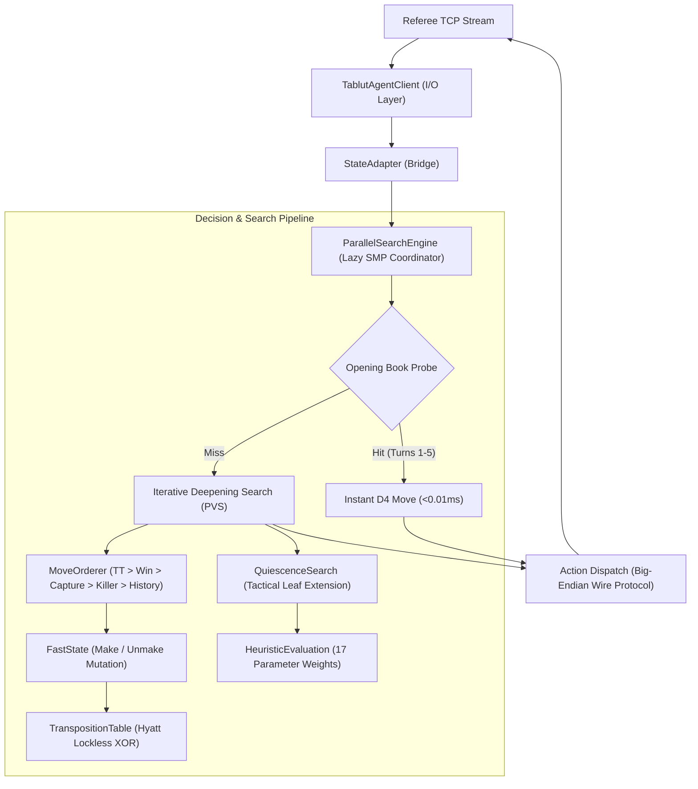

# Ashton Tablut Engine — Architecture & Technical Wiki

Welcome to the technical documentation for the Ashton Tablut autonomous chess-like engine. This wiki covers the internal design, data representations, search algorithms, heuristic formulations, concurrency models, and automated optimization pipelines powering the engine.

The engine is built in zero-allocation Java, targeting execution in restricted tournament environments (Debian Linux, 4 vCPUs, 8 GB RAM, no GPU, offline execution).

---

## 1. Ashton Tablut: Rules and Board Topology

Ashton Tablut is an asymmetric, medieval Nordic board game played on a $9 \times 9$ grid (81 squares, labeled `a1` to `i9`). The game models a siege where an outnumbered defending garrison protects their King against a surrounding army.

```
       a   b   c   d   e   f   g   h   i
    +---+---+---+---+---+---+---+---+---+
  9 |   |   |   | C | C | C |   |   |   | 9
  8 |   |   |   |   | C |   |   |   |   | 8
  7 |   |   |   |   | W |   |   |   |   | 7
  6 |   |   |   |   | W |   |   |   |   | 6
  5 | C | C | W | W | K | W | W | C | C | 5  (Throne: e5)
  4 |   |   |   |   | W |   |   |   |   | 4
  3 |   |   |   |   | W |   |   |   |   | 3
  2 |   |   |   |   | C |   |   |   |   | 2
  1 |   |   |   | C | C | C |   |   |   | 1
    +---+---+---+---+---+---+---+---+---+
       a   b   c   d   e   f   g   h   i
```

### 1.1 The Forces
* **White (Defenders):** 1 King ($K$) positioned at the center Throne (`e5`) and 8 Soldiers ($W$) guarding the four orthogonal cross-axes (`d5, f5, e4, e6, c5, g5, e3, e7`). White wins by navigating the King to any of the peripheral escape squares.
* **Black (Attackers):** 16 Soldiers ($B$) deployed in 4 perimeter encampments (citadels), with 4 soldiers per camp. Black wins by capturing the White King.

### 1.2 Special Squares & Geometric Barriers
1. **The Castle / Throne (`e5`):**
   * Located at the exact board center (`sq = 40`).
   * Only the King may occupy the Throne.
   * Once vacated, no piece may re-enter.
   * Acts as an impassable physical barrier for all sliding moves.
   * Acts as a hostile capture barrier (anvil) for both White and Black against adjacent enemy pieces.
2. **The Citadels / Camps (16 squares):**
   * North: `d9, e9, f9, e8`
   * South: `d1, e1, f1, e2`
   * West: `a4, a5, a6, b5`
   * East: `i4, i5, i6, h5`
   * White pieces cannot enter or pass through any camp square under any condition.
   * Black pieces can move freely within their initial camp until they exit. Once a Black soldier vacates its camp, it cannot re-enter any camp on the board.
   * Camps act as hostile capture barriers (anvils) against adjacent pieces. In Ashton rules, White can use non-entrance camp squares as capture anvils, while Black treats all 16 camp squares as hostile capture barriers.
3. **Escape Squares (16 perimeter squares):**
   * Outer border coordinates excluding corners and camp exits: `b1, c1, g1, h1`, `b9, c9, g9, h9`, `a2, a3, a7, a8`, `i2, i3, i7, i8`.
   * When the King reaches any escape square, White immediately wins.

### 1.3 Mechanics of Movement & Capture
* **Movement:** Pieces slide orthogonally (rook-like) any number of unoccupied squares without jumping over intervening pieces, the Throne, or forbidden camps.
* **Active Custodian Capture:** A soldier is captured when an active move sandwiches it between two opposing hostile entities (two opposing soldiers, or one opposing soldier and a hostile barrier such as the Throne or a Camp). Passive moves do not trigger captures: moving between two enemies voluntarily is safe.
* **King Capture Mechanics:**
  * **On the Throne (`e5`):** Must be surrounded on **all 4 orthogonal sides** by Black soldiers.
  * **Adjacent to the Throne (`e4, e6, d5, f5`):** Must be surrounded on **all 3 free orthogonal sides** by Black soldiers, with the Throne acting as the 4th barrier.
  * **In the Open Field:** Captured via standard 2-sided custodian capture between two Black soldiers, or between one Black soldier and an anvil barrier (Throne or Camp).

---

## 2. Engine Specifications

The engine relies on a modular, zero-allocation design optimized for cache locality and rapid tree expansion:

| Architectural Component | Implementation Detail | Performance Profile |
| :--- | :--- | :--- |
| **State Representation** | Flat 81-byte array (`byte[81]`) with incremental 64-bit Zobrist hashing | **85,048,952 NPS** (raw Perft) |
| **Tree Traversal** | Negamax $\alpha$-$\beta$, Iterative Deepening, PVS, and Aspiration Windows | **>14,000,000 NPS** in live search |
| **Memory Allocation** | Zero heap allocation in search loops; preallocated stack arrays and structs | **0 bytes/sec** GC pressure |
| **Transposition Table** | $2^{21}$ entries (~32 MB), Hyatt lockless XOR verification, distance-normalized scores | **>21,000,000 ops/sec** |
| **Move Ordering** | 5-tier cascade: TT PV $\to$ Winning Moves $\to$ Captures $\to$ Killers $\to$ History | **40.5x** node pruning factor |
| **Tactical Search** | Quiescence search with stand-pat cutoffs and King threat delta pruning bypass | Horizon effect resolved |
| **Opening Book** | $D_4$ Dihedral Symmetry Group (8-fold compression, 784 precomputed states) | **<0.01 ms** response |
| **Parallel Scaling** | Lazy SMP across 4 vCPUs with staggered depth offsets and root move permutations | Linear multi-core scaling |
| **Parameter Tuning** | Simultaneous Perturbation Stochastic Approximation (SPSA) via headless simulator | Multi-night gradient tuning |



---

## 3. Wiki Navigation

The documentation is organized across distinct engineering modules:

1. [**01 — State Representation & Bit Architecture**](01-State-Representation-and-Bit-Architecture.md): Board layout, primitive move packing, stack-allocated undo structs, Ashton capture execution, and 64-bit Zobrist hashing.
2. [**02 — Search & Pruning Algorithms**](02-Search-and-Pruning-Algorithms.md): Negamax, Iterative Deepening, Principal Variation Search (PVS), Aspiration Windows, Quiescence Search, and lazy move ordering.
3. [**03 — Heuristics & Domain Knowledge**](03-Heuristics-and-Domain-Knowledge.md): 17 parameterized domain features, King escape forks, 8-point Rhombus cordon, citadel barriers, and open-field swarm gradients.
4. [**04 — Opening Book & Dihedral Symmetry**](04-Opening-Book-and-Dihedral-Symmetry.md): $D_4$ group theory (8-fold spatial reduction), canonical opening lines, and sub-millisecond table lookups.
5. [**05 — Concurrency & Lazy SMP**](05-Concurrency-and-Lazy-SMP.md): Multi-core scaling on 4 vCPUs, lockless Transposition Table via Hyatt XOR masking, thread staggering, and opponent-turn CPU suppression.
6. [**06 — Offline Tuning Pipeline (SPSA)**](06-Offline-Tuning-Pipeline-SPSA.md): Headless match simulation, simultaneous perturbation gradient approximation, decay schedules, atomic checkpoints, and parameter injection.
7. [**07 — Protocol, CLI & Execution**](07-Protocol-CLI-and-Execution.md): TCP wire framing, dynamic time management, compliance with the Debian competition VM, and strict adversary turn rules.
